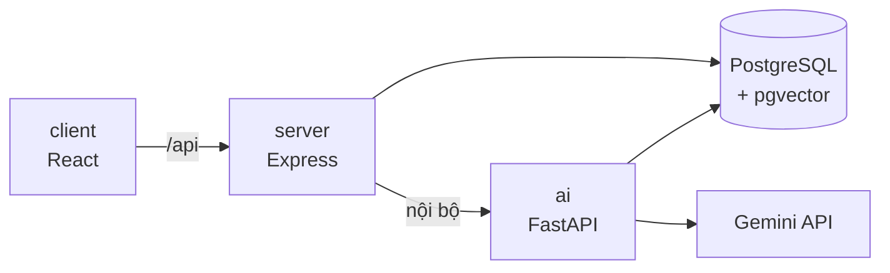

# StudyMate

Nền tảng học tập có trợ lý AI trả lời **dựa trên chính tài liệu của khóa học**. Đồ án môn SE347.

- **Sinh viên** hỏi đáp với chatbot RAG. Câu trả lời có trích dẫn trang để kiểm chứng; câu hỏi nằm ngoài tài liệu sẽ bị từ chối.
- **Giảng viên** tải lên PDF và sinh quiz trắc nghiệm từ tài liệu. Quiz chỉ đến tay sinh viên sau khi giảng viên duyệt.
- **Admin** quản lý tài khoản và theo dõi lượng gọi AI.

## Kiến trúc



Trình duyệt chỉ gọi Express. Express lo đăng nhập, phân quyền và dữ liệu, rồi gọi service Python cho phần AI: ingest PDF, hybrid search (full-text + vector, gộp bằng RRF), sinh câu trả lời có trích dẫn, sinh quiz.

Chi tiết và lý do của từng quyết định: [docs/01-kien-truc-du-an.md](docs/01-kien-truc-du-an.md).

## Thư mục và phân công

| Thư mục | Nội dung | Công nghệ | Phụ trách |
| --- | --- | --- | --- |
| `ai/` | RAG: ingest, tìm kiếm, chat, sinh quiz, đánh giá | Python, FastAPI, Gemini, PyMuPDF, Ragas | Mạnh |
| `client/` | Giao diện web | React, TypeScript, Vite, Tailwind | Nhật |
| `server/` | API, đăng nhập, phân quyền, schema DB | Express, TypeScript, Prisma, Zod | Dũng |
| `shared/` | Schema Zod dùng chung cho client và server | Zod | Cả nhóm |
| `docs/` | Đề tài, kiến trúc, quy trình, báo cáo | Markdown | Cả nhóm |

## Chạy local

Cần cài: Node 24, [uv](https://docs.astral.sh/uv/), Docker Desktop ([hướng dẫn](docs/cai-dat-docker.md)).

```bash
npm install
docker compose up -d                 # PostgreSQL + pgvector
cp server/.env.example server/.env   # lần đầu
cp ai/.env.example ai/.env           # lần đầu; INTERNAL_KEY giống server/.env
npm run db:migrate -w server
```

Chạy ở 3 terminal:

```bash
npm run dev -w server                          # http://localhost:3000
npm run dev -w client                          # http://localhost:5173
cd ai && uv run --env-file .env fastapi dev    # http://localhost:8000
```

Mở http://localhost:5173. Trang hiện `API OK · database OK · AI OK` là đã chạy đủ.

## Kiểm tra trước khi mở PR

```bash
npm run lint && npm run build                  # client, server, shared
cd ai && uv run ruff check && uv run pytest    # ai
```

CI chạy đúng các lệnh này cho mỗi PR.

## Tài liệu

| File | Nội dung |
| --- | --- |
| [docs/00-mo-ta-de-tai.md](docs/00-mo-ta-de-tai.md) | Mô tả đề tài, tính năng, kế hoạch 10 tuần |
| [docs/01-kien-truc-du-an.md](docs/01-kien-truc-du-an.md) | Kiến trúc, các quyết định, cấu trúc thư mục |
| [docs/quy-trinh-lam-viec.md](docs/quy-trinh-lam-viec.md) | Quy trình làm việc của nhóm |
| [CONTRIBUTING.md](CONTRIBUTING.md) | Quy tắc Git, commit, PR |
| [CLAUDE.md](CLAUDE.md) | Quy tắc khi dùng AI để viết code |
