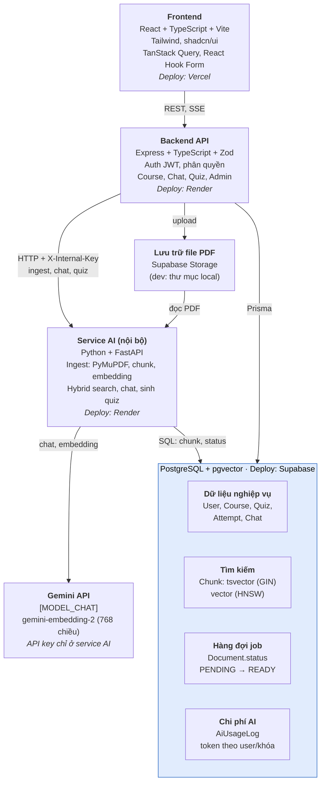
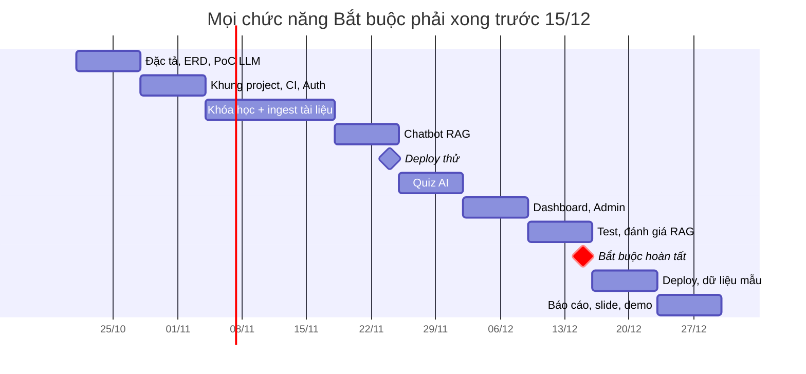

# StudyMate – Báo cáo mô tả đề tài

Cập nhật: 27/10/2026 (kiến trúc theo [01-kien-truc-du-an.md](01-kien-truc-du-an.md))

## 1. Tóm tắt

StudyMate là nền tảng học tập có trợ lý AI. Sinh viên hỏi đáp trên chính tài liệu của khóa học và nhận câu trả lời có trích dẫn trang. Giảng viên sinh quiz tự động từ tài liệu, duyệt rồi mới giao cho lớp.

| Mục | Nội dung |
| --- | --- |
| Môn học | SE347 |
| Nhóm | 3 thành viên: [TV1], [TV2], [TV3] |
| Thời gian | 21/10/2026 – cuối 12/2026 (10 tuần), báo cáo tiến độ hằng tuần |
| Công nghệ chính | React + TypeScript, Express, Python + FastAPI, PostgreSQL + pgvector, Gemini API |
| Tính năng AI | Chatbot RAG có trích dẫn trang; sinh quiz trắc nghiệm dạng JSON |
| Điểm khác biệt | Trích dẫn kiểm chứng được, giảng viên kiểm soát nội dung AI, có số liệu đánh giá chất lượng |

## 2. Bối cảnh, vấn đề và mục tiêu

Sinh viên cần tra cứu nhanh nội dung trong tài liệu môn học, nhưng các công cụ hiện có đều chưa đáp ứng tốt.

**Vấn đề**

- Mỗi môn có hàng chục file PDF slide và giáo trình. Tìm một khái niệm bằng Ctrl+F chỉ hiệu quả khi nhớ đúng từ khóa.
- Chatbot đa dụng trả lời theo kiến thức chung, có thể lệch với nội dung giảng viên dạy và không chỉ ra nguồn để kiểm chứng.
- Giảng viên mất nhiều thời gian soạn câu hỏi ôn tập cho từng chương.
- Giảng viên không biết sinh viên đang vướng ở phần kiến thức nào.

**Mục tiêu**

1. Xây dựng web app quản lý khóa học với 3 vai trò: Sinh viên, Giảng viên, Admin.
2. Chatbot trả lời **chỉ dựa trên tài liệu của khóa học**, kèm trích dẫn tài liệu và số trang, từ chối câu hỏi ngoài phạm vi.
3. Sinh quiz trắc nghiệm từ tài liệu, giảng viên duyệt trước khi xuất bản.
4. Đo được chất lượng chatbot bằng bộ câu hỏi chuẩn, có số liệu cụ thể trong báo cáo.
5. Deploy lên môi trường thật, dùng stack phổ biến trong doanh nghiệp để các thành viên tận dụng khi đi làm.

**So với việc tải PDF lên một chatbot đa dụng**, StudyMate quản lý tài liệu theo lớp và có phân quyền. Sinh viên không phải tự tải tài liệu, giảng viên kiểm soát được nội dung, và hệ thống thu được thống kê học tập của cả lớp.

## 3. Người dùng và vai trò

Hệ thống có 3 vai trò. Quyền truy cập tài liệu và chatbot luôn gắn với khóa học mà người dùng thuộc về.

| Vai trò | Nhu cầu chính | Quyền | Giới hạn |
| --- | --- | --- | --- |
| Sinh viên | Tra cứu nhanh nội dung môn học, tự kiểm tra kiến thức | Tham gia khóa bằng mã lớp, chat với tài liệu, làm quiz, xem kết quả | Chỉ thấy khóa học đã tham gia; số câu hỏi AI mỗi ngày có hạn |
| Giảng viên | Cung cấp tài liệu, ra đề ôn tập nhanh, nắm tình hình lớp | Tạo khóa học, upload tài liệu, sinh và duyệt quiz, xem thống kê lớp | Chỉ quản lý khóa học mình tạo |
| Admin | Vận hành hệ thống, kiểm soát chi phí AI | Quản lý tài khoản, cấp quyền giảng viên, xem log lượt gọi AI | Không chỉnh sửa nội dung khóa học |

Tài khoản mới đăng ký mặc định là Sinh viên. Admin cấp quyền Giảng viên.

## 4. Phạm vi chức năng

Mọi chức năng Bắt buộc phải xong trước tuần 8. Chức năng Điểm cộng chỉ làm khi còn thời gian.

| Nhóm | Chức năng | Mức | Phụ trách |
| --- | --- | --- | --- |
| Tài khoản | Đăng ký, đăng nhập (JWT), đổi mật khẩu, phân quyền 3 vai trò | Bắt buộc | TV1 |
| Tài khoản | Đăng nhập bằng Google | Điểm cộng | TV1 |
| Khóa học | Tạo, sửa, xóa khóa học; sinh mã lớp; sinh viên tham gia bằng mã | Bắt buộc | TV1 |
| Tài liệu | Upload PDF, xử lý nền, hiển thị trạng thái, xem PDF theo trang | Bắt buộc | TV2 |
| Tài liệu | Hỗ trợ DOCX/PPTX; OCR cho PDF scan | Điểm cộng | TV2 |
| Chatbot | Hỏi đáp RAG có streaming, trích dẫn trang, lịch sử hội thoại, từ chối câu ngoài phạm vi | Bắt buộc | TV2 |
| Chatbot | Hybrid search, viết lại câu hỏi nối tiếp | Bắt buộc | TV2 |
| Chatbot | Reranking; gợi ý câu hỏi tiếp theo | Điểm cộng | TV2 |
| Quiz | Sinh quiz bằng AI, giảng viên sửa/duyệt/xuất bản, sinh viên làm bài, chấm điểm tự động, xem giải thích | Bắt buộc | TV3 |
| Quiz | Tự sinh flashcard | Điểm cộng | TV3 |
| Thống kê | Dashboard giảng viên: điểm trung bình, câu sai nhiều nhất | Bắt buộc | TV3 |
| Quản trị | Quản lý tài khoản, giới hạn lượt gọi AI, xem log chi phí | Bắt buộc | TV1 |
| Vận hành | Docker Compose, CI trên GitHub Actions, deploy | Bắt buộc | TV3 |
| Vận hành | Chạy script đánh giá RAG trên CI | Điểm cộng | TV3 |

**Ngoài phạm vi:** thanh toán, ứng dụng di động, chat realtime giữa người với người, tích hợp Moodle, xử lý video bài giảng.

## 5. Luồng nghiệp vụ chính

Có bốn luồng chính. Luồng giảng viên tạo dữ liệu, hai luồng sinh viên dùng dữ liệu đó, luồng admin giám sát hệ thống.

**5.1. Giảng viên chuẩn bị khóa học**

1. Tạo khóa học (tên, mô tả, học kỳ). Hệ thống sinh mã lớp.
2. Upload tài liệu PDF. Request trả về ngay với trạng thái "Đang xử lý".
3. Worker xử lý nền. Trạng thái chuyển sang "Sẵn sàng" hoặc "Lỗi" kèm lý do.
4. Chọn tài liệu hoặc chương, số câu, độ khó, rồi bấm "Tạo quiz".
5. Xem bản nháp: sửa, xóa hoặc thêm câu; mỗi câu hiển thị trang nguồn.
6. Xuất bản quiz cho lớp.

**5.2. Sinh viên hỏi đáp với tài liệu**

1. Nhập mã lớp để tham gia khóa học.
2. Mở chatbot của khóa, đặt câu hỏi, ví dụ "Phân biệt PUT và PATCH?".
3. Câu trả lời hiện dần (streaming), cuối câu có trích dẫn dạng [Chương 3, tr.12].
4. Bấm vào trích dẫn để mở đúng trang PDF.
5. Hỏi nối tiếp ("Còn PATCH thì sao?"); hệ thống hiểu ngữ cảnh từ lịch sử hội thoại.
6. Nếu câu hỏi ngoài phạm vi, bot trả lời "Tài liệu khóa học không đề cập nội dung này".

**5.3. Sinh viên làm quiz**

1. Chọn quiz đã xuất bản trong khóa học.
2. Làm bài và nộp.
3. Xem điểm, đáp án đúng, giải thích và trang nguồn của từng câu.

**5.4. Admin giám sát**

1. Duyệt yêu cầu cấp quyền Giảng viên.
2. Khóa hoặc mở tài khoản vi phạm.
3. Xem số lượt gọi AI và số token theo ngày, theo người dùng, theo khóa học.
4. Điều chỉnh hạn mức câu hỏi mỗi ngày.

## 6. Kiến trúc hệ thống và công nghệ

Hệ thống gồm frontend, backend API (Express) và service AI nội bộ (Python), dùng một PostgreSQL duy nhất cho dữ liệu nghiệp vụ, tìm kiếm và hàng đợi job. Chi tiết và lý do từng quyết định: [01-kien-truc-du-an.md](01-kien-truc-du-an.md).

Trình duyệt chỉ gọi Backend API. Chỉ service AI gọi Gemini, và chỉ Backend API gọi được service AI. GitHub Actions chạy lint, type-check và test cho mỗi Pull Request; Docker Compose dựng PostgreSQL + pgvector khi chạy local.

| Công nghệ | Dùng cho | Lý do chọn |
| --- | --- | --- |
| React + TypeScript + Vite | Giao diện SPA | Phổ biến nhất khi tuyển frontend; Vite build nhanh |
| TailwindCSS + shadcn/ui | Style và component | Dựng giao diện nhanh, không phải tự viết CSS nhiều |
| TanStack Query, React Hook Form | Gọi API, cache dữ liệu; form | Lo sẵn loading, lỗi, refetch; form dùng chung schema Zod |
| Express + TypeScript | REST API, phân quyền, chuyển tiếp SSE | Đơn giản, nhiều tài liệu, dùng chung ngôn ngữ với frontend |
| Zod (workspace `shared/`) | Validate request, response và JSON từ service AI | Một schema dùng cho cả client và server |
| PostgreSQL + pgvector + Prisma | Dữ liệu, vector, full-text | Không cần thêm vector DB riêng; truy vấn vector join được với bảng khác |
| Python + FastAPI + Pydantic | Service AI nội bộ | Hệ sinh thái AI lớn nhất; Pydantic kiểm tra JSON từ LLM |
| google-genai, psycopg 3 | Gọi Gemini; SQL thuần cho hybrid search | Không dùng LangChain để tự viết và trình bày được phần tìm kiếm |
| PyMuPDF | Trích xuất text PDF theo trang | Giữ số trang để trích dẫn; đọc slide tốt |
| Ragas, pytest | Đánh giá chất lượng RAG; test | Chỉ số chuẩn cho RAG |
| Docker Compose, GitHub Actions | Môi trường local, CI | Thành viên có cùng môi trường; PR phải qua CI trước khi merge |
| Vercel, Render, Supabase | Deploy frontend, backend + AI, database + file | Đều có gói miễn phí; Supabase có pgvector và Storage |

## 7. Thiết kế thành phần AI

Phần AI gồm ba khối: pipeline ingest tài liệu, chatbot RAG và sinh quiz. Cả ba dùng chung PostgreSQL làm nơi lưu vector, chỉ mục full-text và hàng đợi công việc.

**7.1. Pipeline ingest (chạy nền, một lần cho mỗi tài liệu)**

1. Backend lưu file, tạo Document ở trạng thái PENDING rồi báo service AI. Service AI nhận việc bằng `SELECT ... FOR UPDATE SKIP LOCKED`, đổi sang PROCESSING. Khi khởi động, service AI quét lại các tài liệu còn PENDING hoặc kẹt ở PROCESSING.
2. Trích xuất text theo từng trang bằng PyMuPDF. Trang không có text được đánh dấu để báo giảng viên.
3. Chia chunk theo trang slide. Mỗi chunk được gắn tên tài liệu và tiêu đề slide ở đầu. Trang dài (giáo trình) được cắt tiếp theo kích thước [X] token, overlap [X].
4. Tính hash nội dung. Chunk trùng hash với chunk đã có thì dùng lại embedding, không gọi API.
5. Tạo embedding theo lô bằng [MODEL_EMBEDDING], retry với thời gian chờ tăng dần khi gặp lỗi 429.
6. Trong một transaction: xóa chunk cũ của tài liệu, ghi chunk mới (nội dung, số trang, tsvector, vector, tên model), đổi trạng thái sang READY.

**7.2. Chatbot RAG (mỗi câu hỏi)**

1. Kiểm tra sinh viên thuộc khóa học và còn hạn mức câu hỏi trong ngày.
2. Nếu đã có lịch sử hội thoại, viết lại câu hỏi thành câu đầy đủ ngữ cảnh.
3. Hybrid search trong phạm vi `courseId`: full-text search và vector search chạy song song, gộp bằng Reciprocal Rank Fusion, lấy top-k = [X].
4. Nếu điểm tương đồng cao nhất thấp hơn ngưỡng [X], trả lời "không tìm thấy" và dừng, không gọi LLM.
5. Dựng prompt: system prompt yêu cầu chỉ dùng ngữ cảnh được cung cấp; các chunk được đánh số [#1]…[#k] và bọc trong thẻ `<document>`.
6. Service AI gọi [MODEL_CHAT] và stream SSE về backend; backend chuyển tiếp nguyên stream về frontend.
7. Khi stream xong, backend đổi ID chunk được trích dẫn thành tài liệu và số trang, loại bỏ ID không hợp lệ, lưu tin nhắn và ghi log token.

**7.3. Sinh quiz**

1. Giảng viên chọn tài liệu hoặc khoảng trang, số câu và độ khó.
2. Service AI chia các chunk thành nhóm vừa ngữ cảnh và sinh câu hỏi theo từng nhóm, tránh dồn cả tài liệu vào một lần gọi.
3. LLM trả về JSON theo schema: câu hỏi, 4 phương án, chỉ số đáp án đúng, giải thích, `sourcePage`.
4. Pydantic kiểm tra JSON ở service AI (sai schema thì gọi lại tối đa [X] lần), backend kiểm tra lại bằng Zod.
5. Loại câu trùng lặp, lưu quiz ở trạng thái DRAFT chờ giảng viên duyệt.

**Nguyên tắc chung:** API key Gemini chỉ nằm ở service AI; tên model đặt trong biến môi trường để đổi nhà cung cấp mà không sửa code. Nhóm chọn model cụ thể sau PoC tuần 1, dựa trên tài liệu chính thức của nhà cung cấp.

## 8. Mô hình dữ liệu và API

Đây là bản phác thảo 12 bảng và các nhóm endpoint chính. Bản chi tiết sẽ nằm trong tài liệu ERD và API của tuần 1.

**8.1. Các bảng chính**

| Bảng | Trường quan trọng | Quan hệ |
| --- | --- | --- |
| User | email (unique), passwordHash, role (STUDENT / TEACHER / ADMIN), isLocked | — |
| Course | name, description, joinCode (unique), teacherId | thuộc 1 User (giảng viên) |
| Enrollment | userId, courseId, joinedAt; unique (userId, courseId) | nối User và Course |
| Document | courseId, title, storageKey, pageCount, status (PENDING / PROCESSING / READY / FAILED), error | thuộc 1 Course |
| Chunk | documentId, page, content, contentHash, tsv (tsvector), embedding (vector(768)), embeddingModel | thuộc 1 Document |
| ChatSession | userId, courseId, title | thuộc User và Course |
| ChatMessage | sessionId, role (user / assistant), content, citations (JSON: chunkId, page) | thuộc 1 ChatSession |
| Quiz | courseId, title, status (DRAFT / PUBLISHED), createdBy | thuộc 1 Course |
| Question | quizId, text, options (JSON), answerIndex, explanation, sourceChunkId | thuộc 1 Quiz |
| Attempt | quizId, userId, score, submittedAt | thuộc Quiz và User |
| AttemptAnswer | attemptId, questionId, chosenIndex, isCorrect | thuộc 1 Attempt |
| AiUsageLog | userId, courseId, task (chat / quiz / embed), inputTokens, outputTokens, createdAt | thuộc User |

Chỉ mục cần có: chỉ mục vector (HNSW) trên `Chunk.embedding`, GIN trên `Chunk.tsv`, và chỉ mục `(status)` trên `Document` cho worker. Prisma chưa hỗ trợ trực tiếp kiểu vector, nên Prisma chỉ tạo cột (migration), còn service AI ghi chunk và chạy truy vấn tìm kiếm bằng SQL thuần (psycopg).

**8.2. Nhóm API chính**

| Nhóm | Endpoint tiêu biểu | Vai trò |
| --- | --- | --- |
| Auth | `POST /auth/register`, `POST /auth/login`, `GET /auth/me` | Mọi người |
| Course | `POST /courses`, `GET /courses`, `POST /courses/join` | Giảng viên tạo; sinh viên tham gia |
| Document | `POST /courses/:id/documents` (multipart), `GET /documents/:id/status` | Giảng viên |
| Chat | `POST /courses/:id/chat` (SSE stream), `GET /chat-sessions/:id` | Sinh viên |
| Quiz | `POST /courses/:id/quizzes/generate`, `PATCH /quizzes/:id`, `POST /quizzes/:id/publish` | Giảng viên |
| Attempt | `POST /quizzes/:id/attempts`, `GET /attempts/:id` | Sinh viên |
| Stats | `GET /courses/:id/stats` | Giảng viên |
| Admin | `GET /admin/users`, `PATCH /admin/users/:id`, `GET /admin/ai-usage` | Admin |

## 9. Yêu cầu phi chức năng

Các yêu cầu dưới đây đều kiểm tra được. Các giá trị [X] sẽ được chốt sau PoC tuần 1.

| Nhóm | Yêu cầu | Cách kiểm tra |
| --- | --- | --- |
| Bảo mật | Mật khẩu hash bằng bcrypt; JWT có thời hạn; API key AI chỉ nằm ở backend | Review code; tìm key trong bundle frontend |
| Bảo mật | Mọi request đều được validate bằng Zod; upload chỉ nhận PDF ≤ [X] MB | Test gửi dữ liệu sai và file sai định dạng |
| Bảo mật | Mọi truy vấn tài liệu và vector đều lọc theo `courseId` và kiểm tra quyền thành viên | Test dùng tài khoản lớp A hỏi tài liệu lớp B |
| Bảo mật | Nội dung tài liệu được coi là dữ liệu, không phải lệnh (chống prompt injection) | Đưa vào golden set một PDF chứa câu lệnh giả |
| Hiệu năng | Chatbot hiện token đầu tiên trong ≤ [X] giây | Đo trên môi trường deploy |
| Hiệu năng | Request upload trả về ngay, không chờ xử lý xong | Đo thời gian phản hồi với file [X] trang |
| Chi phí | Mỗi người dùng tối đa [X] câu hỏi AI mỗi ngày; mọi lượt gọi đều ghi log token | Test vượt hạn mức; xem dashboard Admin |
| Tin cậy | Worker lỗi giữa chừng thì chạy lại được, không sinh chunk trùng | Ngắt worker giữa chừng rồi chạy lại, đếm số chunk |
| Giao diện | Dùng được trên màn hình 375 px và 1440 px | Kiểm tra thủ công trên hai kích thước |
| Chất lượng code | TypeScript strict; CI chạy lint, type-check và test cho mỗi Pull Request | GitHub Actions phải xanh trước khi merge |

## 10. Thách thức kỹ thuật và phương pháp đánh giá

Thách thức lớn nhất không nằm ở việc gọi API LLM. Nó nằm ở ba điểm: truy xuất đúng đoạn tài liệu, chứng minh hệ thống trả lời đúng, và xử lý tài liệu một cách tin cậy. Phân tích đầy đủ nằm trong [chương 6](06-thach-thuc-va-huong-phat-trien.md).

| Nút thắt | Vì sao khó | Giải pháp |
| --- | --- | --- |
| Chất lượng retrieval | Slide ít chữ nên mất ngữ cảnh; vector search bỏ sót từ khóa chính xác ("404"); câu hỏi nối tiếp thiếu ngữ cảnh; tài liệu trộn Việt–Anh | Chunk theo trang kèm tiêu đề; hybrid search gộp bằng RRF; viết lại câu hỏi; model embedding đa ngôn ngữ |
| Đánh giá hệ thống | Đầu ra LLM không tất định, không kiểm bằng unit test được; thiếu số liệu thì mọi tinh chỉnh chỉ là đoán | Golden set ~25 câu và script đánh giá chạy lại được |
| Pipeline ingest bất đồng bộ | Hàng trăm lượt gọi embedding cho mỗi file; dễ timeout, dính rate limit, hỏng giữa chừng | Cột status + worker `SKIP LOCKED`; gửi theo lô, retry; xử lý idempotent trong transaction |

**Golden set:** khoảng 25 câu hỏi soạn từ tài liệu môn học, gồm bốn loại: tra cứu trực tiếp, từ khóa chính xác, câu hỏi nối tiếp, và câu ngoài phạm vi. Mỗi câu ghi sẵn đáp án mong đợi và trang chứa đáp án.

**Ba chỉ số:**

- **Hit@k:** tỷ lệ câu hỏi có trang đúng nằm trong top-k đoạn truy xuất được.
- **Độ đúng câu trả lời:** tỷ lệ câu trả lời đủ ý chính và không có thông tin sai. Với câu ngoài phạm vi, từ chối được tính là đúng.
- **Độ chính xác trích dẫn:** tỷ lệ trích dẫn trỏ đến trang thực sự chứa thông tin được nêu.

Nhóm sẽ chạy đánh giá trên ba cấu hình (chỉ vector, hybrid, hybrid + viết lại câu hỏi) để có số liệu so sánh trong báo cáo.

## 11. Kế hoạch và phân công

Dự án kéo dài 10 tuần, mỗi tuần kết thúc bằng một sản phẩm demo được cho báo cáo tuần. Ba tuần cuối dành cho deploy, báo cáo và dự phòng trễ tiến độ.

Deploy thử từ tuần 5 để phát hiện sớm lỗi streaming trên server. Sau mốc 15/12, nhóm chỉ sửa lỗi và làm Điểm cộng.

**Phân công theo tuần.** Mỗi thành viên làm trọn chức năng của mình từ backend đến giao diện. TV1 phụ trách Auth, khóa học, Admin; TV2 phụ trách pipeline tài liệu và chatbot RAG; TV3 phụ trách quiz, dashboard và DevOps.

| Tuần | TV1 | TV2 | TV3 | Sản phẩm báo cáo tuần |
| --- | --- | --- | --- | --- |
| 1 (21/10) | Đặc tả, use case | PoC gọi LLM + embedding với câu hỏi tiếng Việt | ERD, danh sách API, tạo repo và quy tắc Git | Bộ tài liệu thiết kế, kết quả PoC |
| 2 (28/10) | Đăng ký, đăng nhập JWT, phân quyền | Schema Prisma, migration pgvector | Docker Compose, CI, khung frontend/backend | Đăng nhập chạy được, CI xanh |
| 3 (4/11) | CRUD khóa học, mã lớp, tham gia lớp | Upload PDF, parse theo trang | Layout chung, trang khóa học | Tạo khóa học và upload tài liệu |
| 4 (11/11) | Quản lý thành viên lớp | Worker ingest, chunk, embedding, hybrid search | Trình xem PDF theo trang | Tìm kiếm trả đúng đoạn cho câu hỏi mẫu |
| 5 (18/11) | Hạn mức câu hỏi, AiUsageLog | Chatbot RAG qua SSE, trích dẫn trang | Giao diện chat, deploy thử | Chat có trích dẫn trên bản deploy thử |
| 6 (25/11) | Làm bài quiz, chấm điểm (phía sinh viên) | Viết lại câu hỏi nối tiếp, ngưỡng từ chối | Sinh quiz JSON + Zod, màn duyệt quiz | Sinh, duyệt và làm quiz |
| 7 (2/12) | Trang Admin | Soạn golden set, script đánh giá | Dashboard giảng viên | Dashboard, Admin, số liệu đánh giá đầu tiên |
| 8 (9/12) | Test, sửa lỗi, responsive | Chạy đánh giá trên 3 cấu hình | Test, sửa lỗi, responsive | Mọi chức năng Bắt buộc hoàn tất, bảng kết quả đánh giá |
| 9 (16/12) | Dữ liệu mẫu (seed) | Điểm cộng nếu còn thời gian (reranking) | Deploy chính thức | Link deploy |
| 10 (23/12) | Slide thuyết trình | Chương AI và đánh giá trong báo cáo | Video demo dự phòng | Báo cáo tổng kết, tập demo |

Mỗi báo cáo tuần gồm: việc đã làm kèm link Pull Request, khó khăn gặp phải, và kế hoạch tuần sau.

## 12. Rủi ro và phương án dự phòng

Rủi ro lớn nhất là chất lượng RAG kém trên slide tiếng Việt. Vì vậy PoC tuần 1 phải kiểm tra ngay điểm này.

| Rủi ro | Dấu hiệu sớm | Phương án dự phòng |
| --- | --- | --- |
| RAG trả lời kém trên tài liệu tiếng Việt | PoC tuần 1 cho kết quả truy xuất sai với câu hỏi mẫu | Đổi model embedding; tăng trọng số full-text trong hybrid search |
| Hết hạn mức miễn phí của API AI | Log token tăng nhanh trong lúc test | Giảm hạn mức mỗi người; dùng model nhỏ hơn khi phát triển; đổi nhà cung cấp qua biến môi trường |
| API AI lỗi hoặc chậm đúng lúc demo | Thời gian phản hồi dao động mạnh | Quay video demo dự phòng; chuẩn bị sẵn dữ liệu mẫu đã xử lý |
| Một thành viên chậm tiến độ | Task trễ quá 1 tuần trong báo cáo tuần | Chuyển chức năng Điểm cộng sang sau; các thành viên còn lại hỗ trợ phần Bắt buộc |
| Deploy gặp lỗi streaming hoặc timeout | SSE chạy ở local nhưng không chạy trên server | Deploy thử từ tuần 5, không để dồn đến tuần 9 |
| PDF của giảng viên là bản scan | Nhiều trang không có text sau khi parse | Báo rõ cho giảng viên; dùng tài liệu có lớp text cho demo; OCR để ở phần Điểm cộng |
| Phạm vi phình to | Đến tuần 6 còn chức năng Bắt buộc chưa bắt đầu | Đóng băng Điểm cộng; chỉ làm Bắt buộc cho đến tuần 8 |

## 13. Hướng phát triển

Hướng phát triển được chia theo mức độ khả thi, từ việc làm được ngay trong đồ án đến định hướng sản phẩm.

| Mức | Hướng | Giá trị mang lại |
| --- | --- | --- |
| Trong đồ án | Reranking sau hybrid search, so sánh trước/sau trên golden set | Tăng độ chính xác truy xuất, có số liệu chứng minh |
| Trong đồ án | Flashcard tự động, gợi ý câu hỏi tiếp theo | Thêm cách ôn tập ngoài quiz |
| Trong đồ án | Chạy script đánh giá RAG trên GitHub Actions | Phát hiện chất lượng giảm khi đổi prompt hoặc tham số |
| Trung hạn | Học tập thích ứng: phát hiện lỗ hổng kiến thức từ kết quả quiz và câu hỏi chat, đề xuất ôn theo lặp lại ngắt quãng | Cá nhân hóa việc học |
| Trung hạn | Chế độ gia sư Socratic: gợi mở từng bước thay vì đưa đáp án | Hạn chế dùng AI để làm hộ bài |
| Trung hạn | Đa phương tiện: mô tả hình và sơ đồ trong slide bằng vision model, OCR cho PDF scan, chuyển video bài giảng thành văn bản | Mở rộng loại tài liệu dùng được |
| Trung hạn | Gom cụm câu hỏi của sinh viên cho giảng viên | Biết phần nào cả lớp đang khó |
| Dài hạn | Tích hợp vào LMS sẵn có như Moodle qua chuẩn LTI | Dùng trong hệ thống của trường thay vì nền tảng riêng |
| Dài hạn | Đồ thị tri thức khái niệm (GraphRAG) | Trả lời câu hỏi cần liên kết nhiều chương |
| Dài hạn | Tự host model mã nguồn mở; chuyển sang hàng đợi chuyên dụng | Dữ liệu không rời khỏi trường; chịu được quy mô lớn |

## 14. Các vấn đề nhóm cần quyết định

Những điểm sau cần chốt trong tuần 1, trước khi viết code.

- [ ] Chốt đề tài StudyMate hay chuyển sang phương án dự phòng (Job portal có AI)?
- [ ] Chọn nhà cung cấp và model cho chat và embedding sau PoC; kiểm tra hạn mức miễn phí trên tài liệu chính thức.
- [ ] Nơi lưu file PDF: ổ đĩa server, Cloudinary hay Supabase Storage?
- [ ] Chốt các tham số [X]: kích thước file tối đa, hạn mức câu hỏi mỗi ngày, top-k, ngưỡng similarity.
- [ ] Bộ tài liệu dùng cho demo và golden set: slide môn nào, có cần xin phép giảng viên không?
- [ ] Phân công chính thức: ai là TV1, TV2, TV3; ai phụ trách tổng hợp báo cáo tuần.
- [ ] Quy tắc làm việc với Git: đặt tên nhánh, số người review tối thiểu cho mỗi Pull Request.
