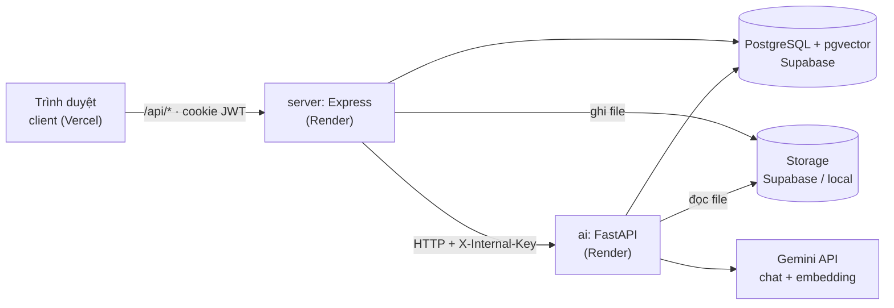
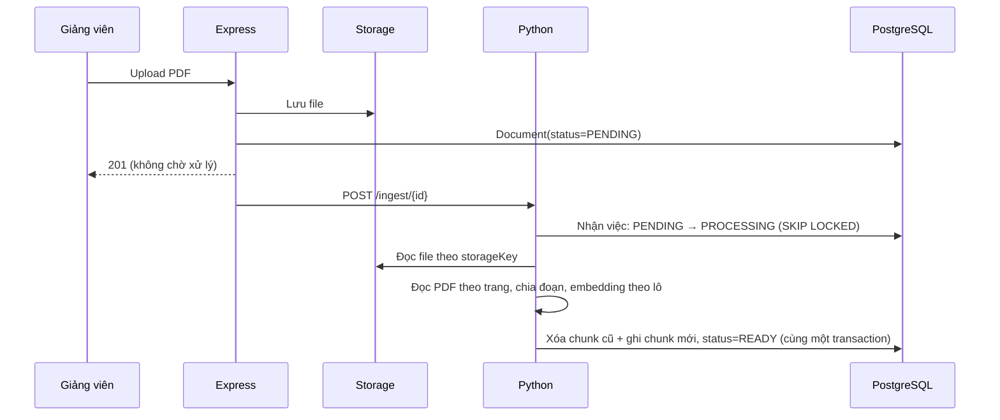

# Kiến trúc và cấu trúc dự án StudyMate

Tổng hợp từ buổi chốt thiết kế ngày 26/10/2026 (27 quyết định). Đây là căn cứ để dựng cấu trúc thư mục; sửa quyết định nào thì cập nhật file này trước.

## 1. Tổng quan

Gồm 3 service và 1 thư viện dùng chung, đặt trong một repo:

| Thư mục | Vai trò | Công nghệ |
| --- | --- | --- |
| `client/` | Giao diện web | React 19 + TypeScript + Vite + Tailwind + shadcn, React Router, TanStack Query, React Hook Form |
| `server/` | API công khai duy nhất: đăng nhập, phân quyền, CRUD, upload, chuyển tiếp stream | Express 5 + TypeScript + Prisma 7 + Zod |
| `ai/` | Service AI nội bộ: ingest, hybrid search, chat có trích dẫn, sinh quiz, đánh giá | Python + FastAPI + uv, google-genai, psycopg 3, PyMuPDF, Ragas (chỉ dùng cho đánh giá) |
| `shared/` | Schema Zod dùng chung cho client và server | TypeScript + Zod |

`client/`, `server/` và `shared/` là npm workspace. `ai/` là project Python riêng, không thuộc npm workspace.



Các quy tắc ranh giới:

- Trình duyệt chỉ gọi Express. Python không có endpoint công khai.
- Chỉ Express kiểm tra quyền. Python không biết người dùng là ai, chỉ nhận `courseId` hoặc `documentId` mà Express đã kiểm tra.
- Prisma là nơi duy nhất tạo migration. Python chỉ dùng SQL thuần để đọc/ghi bảng `Chunk` và cập nhật `Document.status`.
- Python không lưu gì về chat. Tin nhắn và `AiUsageLog` do Express ghi.

## 2. Bảng quyết định

| # | Chủ đề | Quyết định |
| --- | --- | --- |
| Q1 | Khung dự án | Giữ monorepo hiện có (npm workspaces) |
| Q2 | Đặt phần RAG ở đâu | Service Python riêng (FastAPI); ưu tiên vì CV |
| Q3 | Tổ chức backend | Chia theo tính năng: `modules/{auth,course,document,chat,quiz,admin}` |
| Q4 | Kiểu dùng chung | Workspace `shared/`, chỉ chứa schema Zod |
| Q5 | Frontend | Chia theo tính năng + React Router |
| Q6 | Test TypeScript | Vitest + Supertest, test chạy trên PostgreSQL thật trong Docker |
| Q7 | Lưu file | Khi dev lưu local; khi deploy dùng storage tương thích S3 |
| Q8 | Đăng nhập | JWT trong cookie httpOnly, `SameSite=Lax`, hạn 7 ngày, chưa có refresh token; chạy chung domain qua proxy |
| Q9 | Stream chat | SSE |
| Q10 | LLM | Google Gemini cho cả chat và embedding |
| Q11 | Hạ tầng deploy | Supabase cho cả PostgreSQL và Storage (thay Neon) |
| Q12 | Chia việc Express / Python | Express: auth, quyền, CRUD, upload, chuyển tiếp stream. Python: ingest, tìm kiếm, sinh câu trả lời, sinh quiz, đánh giá |
| Q13 | Schema DB | Prisma là chủ duy nhất; Python dùng SQL thuần (psycopg 3) |
| Q14 | Ingest | Express gọi `POST /ingest/{id}` mà không chờ; Python xử lý ở background task; lúc khởi động quét lại `PENDING` và các bản ghi kẹt ở `PROCESSING` |
| Q15 | Thư viện Python | FastAPI, Pydantic, google-genai, psycopg 3, PyMuPDF; không dùng LangChain/LlamaIndex; Ragas chỉ dùng cho đánh giá |
| Q16 | Đường đi của stream | Python → SSE (`token`, `citations`, `done`, `error`) → Express chuyển tiếp nguyên vẹn → client đọc bằng `fetch` + `ReadableStream`; bỏ Vercel AI SDK |
| Q17 | Embedding | `gemini-embedding-2`, 768 chiều, `vector(768)` + index HNSW |
| Q18 | Công cụ Python | pytest + ruff; CI có thêm job Python; dev chạy bằng `uv run fastapi dev`; deploy là web service thứ hai trên Render free |
| Q19 | Hợp đồng Express ↔ Python | Dưới 5 endpoint; Pydantic ở Python, chép tay sang Zod trong `shared/src/internal.ts`; quá khoảng 8 endpoint thì chuyển sang sinh tự động từ OpenAPI |
| Q20 | Luồng chat | Express lưu tin nhắn người dùng, gửi câu hỏi + 6 tin nhắn gần nhất + `courseId`; khi nhận `done` thì lưu câu trả lời và ghi `AiUsageLog` |
| Q21 | Luồng sinh quiz | Request đồng bộ, không stream; dùng structured output của Gemini, kiểm tra bằng Pydantic rồi kiểm tra lại bằng Zod, lưu ở trạng thái `DRAFT` |
| Q22 | Python đọc PDF | Đọc theo `storageKey`: khi dev đọc từ `UPLOAD_DIR`, khi deploy đọc từ Supabase bằng key chỉ có quyền đọc |
| Q23 | Prompt injection | Bọc nội dung chunk trong thẻ phân cách; model không được cấp công cụ nào; ID trích dẫn phải nằm trong danh sách chunk đã gửi: Python loại ID lạ và ánh xạ sang `{chunkId, documentId, page}` trước khi gửi sự kiện `citations`, vì Express chuyển tiếp stream nguyên vẹn (Q16) và chỉ lưu lại |
| Q24 | Hạn mức AI | Đếm `AiUsageLog` theo ngày: 50 câu chat và 10 lần sinh quiz mỗi người dùng, chỉnh được qua biến môi trường; vượt thì trả 429 |
| Q25 | Cấu trúc `ai/` | Mỗi việc một file, chưa chia package con; file nào quá khoảng 300 dòng thì tách |
| Q26 | Cấu trúc `server/` và `shared/` | Xem mục 3 |
| Q27 | Thư viện client | TanStack Query + React Hook Form |

## 3. Cấu trúc thư mục

```
studymate/
├─ client/src/
│  ├─ main.tsx  router.tsx
│  ├─ lib/api.ts               # wrapper fetch, gửi kèm cookie
│  ├─ lib/sse.ts               # đọc stream chat
│  ├─ components/ui/           # shadcn
│  └─ features/{auth,course,document,chat,quiz,admin}/
│                              # trang, component, hook của từng tính năng
├─ server/
│  ├─ prisma/                  # schema.prisma + migrations (nguồn duy nhất)
│  └─ src/
│     ├─ index.ts              # tạo app, gắn router
│     ├─ db.ts
│     ├─ lib/
│     │  ├─ auth.ts            # JWT, requireAuth, requireRole
│     │  ├─ errors.ts          # middleware xử lý lỗi
│     │  ├─ storage.ts         # lưu file local / Supabase
│     │  └─ ai-client.ts       # gọi Python, chuyển tiếp SSE
│     └─ modules/{auth,course,document,chat,quiz,admin}/
│        └─ routes.ts          # chỉ thêm service.ts khi logic đủ dài
├─ shared/src/
│  ├─ auth.ts  course.ts  quiz.ts
│  ├─ chat.ts                  # định dạng trích dẫn, các loại sự kiện SSE
│  └─ internal.ts              # hợp đồng Express ↔ Python
├─ ai/
│  ├─ pyproject.toml  uv.lock  .env.example
│  ├─ app/
│  │  ├─ main.py               # FastAPI, các route, kiểm tra X-Internal-Key
│  │  ├─ config.py  db.py  storage.py
│  │  ├─ ingest.py             # đọc PDF → chia đoạn → embedding, quét PENDING
│  │  ├─ retrieval.py          # viết lại câu hỏi, hybrid search, RRF, ngưỡng từ chối
│  │  ├─ chat.py               # dựng prompt, stream SSE
│  │  └─ quiz.py               # structured output
│  ├─ eval/
│  │  ├─ golden.jsonl          # ~25 câu hỏi mẫu
│  │  └─ run_eval.py           # Hit@k + Ragas
│  └─ tests/
├─ docker-compose.yml          # chỉ chạy PostgreSQL + pgvector
└─ .github/workflows/ci.yml    # job Node + job Python
```

## 4. API nội bộ (Express → Python)

| Endpoint | Dùng cho | Trả về |
| --- | --- | --- |
| `POST /ingest/{documentId}` | Bắt đầu ingest | `202`, xử lý ở nền |
| `POST /chat` | `{question, history[≤6], courseId}` | Stream SSE: `token` · `citations` · `done{usage}` · `error` |
| `POST /quiz/generate` | `{documentId, count}` | JSON danh sách câu hỏi + `usage` |
| `GET /health` | Kiểm tra service còn sống | `{ok}` |

Mọi request đều phải có header `X-Internal-Key`.

## 5. Các luồng chính

### Ingest



Lúc khởi động, Python quét lại các tài liệu còn `PENDING` hoặc kẹt ở `PROCESSING` quá lâu. Vì vậy server có khởi động lại thì cũng không mất việc.

### Chat

```mermaid
sequenceDiagram
    participant U as Sinh viên
    participant E as Express
    participant P as Python
    participant DB as PostgreSQL
    U->>E: POST /api/chat (cookie)
    E->>DB: Kiểm tra quyền, hạn mức; lưu tin nhắn người dùng
    E->>P: POST /chat {question, history, courseId}
    P->>P: Viết lại câu hỏi → hybrid search → kiểm tra ngưỡng → gọi Gemini
    P-->>E: SSE token... citations, done{usage}
    E-->>U: Chuyển tiếp nguyên stream
    E->>DB: Lưu câu trả lời + AiUsageLog
```

### Sinh quiz

Giảng viên bấm sinh quiz. Express kiểm tra quyền và hạn mức rồi gọi `POST /quiz/generate`. Python gọi Gemini với structured output và kiểm tra kết quả bằng Pydantic. Express kiểm tra lại bằng Zod, lưu `Quiz(status=DRAFT)` và ghi `AiUsageLog`. Sau đó giảng viên xem lại và duyệt.

## 6. Môi trường

| | Dev | Deploy |
| --- | --- | --- |
| Client | `npm run dev -w client` (Vite proxy `/api`) | Vercel, chuyển tiếp `/api/*` sang Render |
| Server | `npm run dev -w server` | Render free |
| AI | `uv run fastapi dev` (trong `ai/`) | Render free (web service thứ hai) |
| DB | Docker `pgvector/pgvector:pg17` | Supabase Postgres |
| File | Thư mục `UPLOAD_DIR` dùng chung | Supabase Storage |

Biến môi trường mới cần thêm:

- Server: `AI_SERVICE_URL`, `INTERNAL_KEY`, `JWT_SECRET`, `UPLOAD_DIR`, `SUPABASE_*`, `QUOTA_CHAT_PER_DAY`, `QUOTA_QUIZ_PER_DAY`.
- AI: `DATABASE_URL`, `INTERNAL_KEY`, `GEMINI_API_KEY`, `UPLOAD_DIR`, `SUPABASE_*`.

Render free tạm ngủ sau một thời gian không có truy cập, và project Supabase free tạm dừng sau 7 ngày không hoạt động. Trước buổi demo cần mở trang trước vài phút.

## 7. Việc còn để PoC tuần 1 quyết định

- Tên model chat Gemini cụ thể và hạn mức thật của gói miễn phí: kiểm tra trên AI Studio.
- Ngưỡng tương đồng để từ chối câu hỏi ngoài phạm vi, và giá trị `k` của top-k.
- Kiểm tra PyMuPDF trên slide thật của môn học.

## 8. Đã dựng (27/10/2026)

- `shared/`: schema `healthResponse` và hợp đồng nội bộ `aiHealthResponse`; tự build khi `npm install` (script `prepare`).
- `ai/`: FastAPI với `GET /health`, bắt buộc header `X-Internal-Key`; có pytest cho việc kiểm tra key.
- `server/src/lib/ai-client.ts`: gọi service AI; `/api/health` trả `{ok, db, ai}`.
- Schema: `Document.storageKey`, `Chunk.embedding vector(768)`. Migration `init` được sinh lại vì chưa áp dụng lên DB nào.
- CI: thêm job `ai` (ruff, pytest).
- Tài liệu `00`, `06`, README, CONTRIBUTING đã cập nhật theo kiến trúc mới.

Chưa dựng (thêm khi làm đến tính năng tương ứng): các thư mục `modules/*`, `lib/auth.ts`, `lib/storage.ts` ở server; `features/*`, router, TanStack Query ở client; các file `ingest.py`, `retrieval.py`… ở `ai/`; chỉ mục HNSW và GIN.
