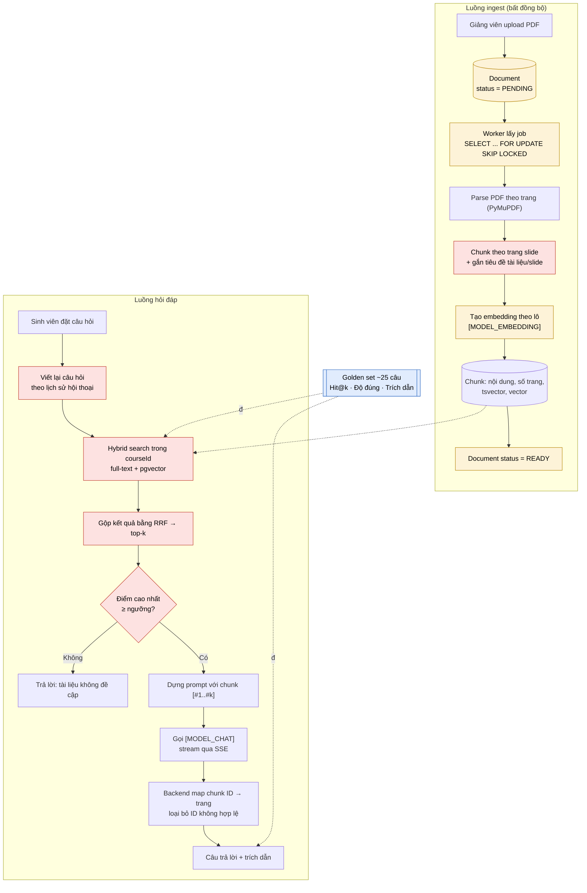

# Chương 6. Thách thức kỹ thuật và Hướng phát triển

Chương này trình bày các thách thức kỹ thuật chính khi xây dựng StudyMate, giải pháp nhóm lựa chọn cho từng thách thức, phương pháp đánh giá hệ thống và các hướng phát triển trong tương lai. Trọng tâm là phần trợ lý AI, bao gồm chatbot RAG có trích dẫn trang và tính năng sinh quiz, vì đây là thành phần có độ bất định cao nhất của hệ thống.

## 6.1. Tổng quan luồng hỏi đáp và vị trí các nút thắt

Sơ đồ dưới đây mô tả luồng xử lý từ lúc giảng viên tải tài liệu lên đến lúc sinh viên nhận câu trả lời. Các nút được tô màu tương ứng với ba nút thắt chính: **(N1)** chất lượng retrieval, **(N2)** đánh giá hệ thống, **(N3)** pipeline ingest bất đồng bộ.

## 6.2. Ba nút thắt chính

### 6.2.1. N1 – Chất lượng retrieval

**Mô tả vấn đề.** Trong kiến trúc RAG, chất lượng câu trả lời bị giới hạn bởi chất lượng các đoạn văn bản được truy xuất. Nếu bước retrieval trả về sai ngữ cảnh, mô hình ngôn ngữ sẽ trả lời sai hoặc từ chối trả lời, kể cả khi thông tin đúng có tồn tại trong tài liệu. Đây là nút thắt quan trọng nhất của hệ thống.

**Ví dụ trên tài liệu môn học.** Slide bài giảng SE347 thường có ít chữ và trình bày dạng gạch đầu dòng. Một trang slide về REST có thể chỉ gồm hai dòng "Stateless" và "Uniform interface". Khi tách riêng, đoạn này không chứa từ "REST" nên embedding của nó không gần với câu hỏi "Đặc điểm của REST là gì?". Có thêm ba tình huống khó:

- Sinh viên hỏi theo từ khóa chính xác như "mã lỗi 404" hay "phương thức PATCH". Tìm kiếm vector thuần túy có thể ưu tiên đoạn nói về "mã lỗi 500" vì hai đoạn gần nhau về ngữ nghĩa.
- Sinh viên hỏi nối tiếp, ví dụ "Còn PATCH thì khác gì?". Câu hỏi này thiếu ngữ cảnh nếu đứng riêng.
- Tài liệu và câu hỏi thường trộn tiếng Việt với thuật ngữ tiếng Anh.

**Giải pháp nhóm áp dụng.**

1. *Chunk theo trang slide và gắn tiêu đề:* mỗi chunk tương ứng với một trang, phía trước có tên tài liệu và tiêu đề slide, ví dụ "Chương 3 – HTTP & REST › Đặc điểm của REST". Cách này giữ được ngữ cảnh cho các slide ít chữ, đồng thời giúp ánh xạ trích dẫn ra số trang một cách tự nhiên.
2. *Hybrid search:* kết hợp full-text search của PostgreSQL (`tsvector`) để bắt từ khóa chính xác với pgvector để bắt tương đồng ngữ nghĩa. Hai danh sách kết quả được gộp bằng Reciprocal Rank Fusion (RRF). Cả hai cơ chế chạy trong cùng một cơ sở dữ liệu nên không phát sinh thêm hệ thống mới, và mọi truy vấn đều được lọc theo `courseId`.
3. *Viết lại câu hỏi:* với câu hỏi nối tiếp, hệ thống dùng lịch sử hội thoại để viết lại thành câu hỏi đầy đủ trước khi truy xuất.
4. *Chọn model embedding đa ngôn ngữ:* nhóm kiểm thử với câu hỏi tiếng Việt ngay trong PoC tuần 1.

**Giới hạn còn lại.** Hệ thống chưa xử lý được nội dung nằm trong hình ảnh, sơ đồ hoặc PDF dạng scan, vì PyMuPDF (không bật OCR) chỉ trích xuất được lớp văn bản. Các câu hỏi cần tổng hợp thông tin từ nhiều chương có thể vượt quá phạm vi top-k. Hệ thống chưa có bước reranking.

### 6.2.2. N2 – Đánh giá hệ thống

**Mô tả vấn đề.** Đầu ra của mô hình ngôn ngữ không tất định và khó kiểm thử bằng unit test truyền thống. Nếu không có phép đo định lượng, mọi điều chỉnh tham số (kích thước chunk, top-k, ngưỡng similarity, nội dung prompt) đều chỉ dựa trên cảm tính. Nhóm cũng không thể chứng minh hệ thống trả lời đúng khi bảo vệ.

**Ví dụ trên tài liệu môn học.** Khi tăng top-k từ [X] lên [X], một số câu hỏi về HTTP có thể được trả lời tốt hơn, nhưng câu hỏi về CSS có thể bị nhiễu thêm. Thử thủ công vài câu hỏi không đủ để phát hiện những thay đổi ngược chiều như vậy.

**Giải pháp nhóm áp dụng.** Nhóm xây dựng một golden set khoảng 25 câu hỏi và viết script đánh giá chạy lại được sau mỗi thay đổi. Chi tiết phương pháp được trình bày ở mục 6.4.

**Giới hạn còn lại.** Golden set có quy mô nhỏ và do chính nhóm soạn, nên có thể chưa đại diện cho cách sinh viên thực sự đặt câu hỏi. Tiêu chí "độ đúng câu trả lời" vẫn có yếu tố chủ quan khi chấm thủ công.

### 6.2.3. N3 – Pipeline ingest bất đồng bộ

**Mô tả vấn đề.** Một tài liệu dài cần hàng trăm lần gọi API embedding. Nếu xử lý đồng bộ trong request upload, hệ thống gặp ba rủi ro: request bị timeout, bị nhà cung cấp giới hạn tốc độ (HTTP 429), và lỗi giữa chừng để lại dữ liệu không nhất quán, chẳng hạn một nửa số chunk đã lưu còn nửa kia chưa.

**Ví dụ trên tài liệu môn học.** Giảng viên tải lên giáo trình khoảng [X] trang cùng lúc với bộ slide các chương. Nếu worker dừng giữa chừng rồi chạy lại mà không dọn dữ liệu cũ, chunk sẽ bị nhân đôi, dẫn đến kết quả truy xuất trùng lặp.

**Giải pháp nhóm áp dụng.**

1. Bảng `Document` có cột `status` với các trạng thái `PENDING → PROCESSING → READY / FAILED`. Request upload trả về ngay, giao diện hiển thị trạng thái xử lý.
2. Worker chạy nền lấy job bằng `SELECT ... FOR UPDATE SKIP LOCKED`. Nhờ vậy nhiều worker có thể chạy song song mà không xử lý trùng một tài liệu, và hệ thống không cần thêm Redis hay hàng đợi riêng.
3. Embedding được gửi theo lô và có retry với thời gian chờ tăng dần khi gặp lỗi 429.
4. Việc xử lý có tính idempotent: trước khi xử lý lại một tài liệu, worker xóa toàn bộ chunk cũ của tài liệu đó trong cùng một transaction.

**Giới hạn còn lại.** Hàng đợi dựa trên bảng phù hợp với quy mô đồ án, nhưng khi số lượng tài liệu và worker tăng lớn, việc polling cơ sở dữ liệu sẽ trở thành gánh nặng. Khi đó cần chuyển sang hàng đợi chuyên dụng.

## 6.3. Các thách thức phụ

Trạng thái được cập nhật theo tiến độ dự án. Tại thời điểm viết, tất cả đều ở trạng thái dự kiến.

| Vấn đề | Giải pháp | Trạng thái |
|---|---|---|
| **Trích dẫn sai trang:** mô hình tự sinh số trang không có thật | Đánh số chunk `[#1]…[#k]` trong prompt và yêu cầu chỉ trích dẫn theo số đó; backend ánh xạ ID sang tài liệu và số trang, loại bỏ mọi ID không thuộc tập đã truy xuất | [Dự kiến] |
| **Câu hỏi ngoài phạm vi:** mô hình trả lời bằng kiến thức chung thay vì từ chối | Nếu điểm tương đồng cao nhất thấp hơn ngưỡng thì trả lời "tài liệu không đề cập" mà không gọi LLM; system prompt yêu cầu chỉ dùng ngữ cảnh được cung cấp; ngưỡng được hiệu chỉnh trên golden set | [Dự kiến] |
| **Prompt injection trong tài liệu:** PDF chứa câu lệnh nhằm thay đổi hành vi mô hình | Bọc nội dung tài liệu trong thẻ `<document>`; system prompt quy định nội dung trong thẻ chỉ là dữ liệu tham khảo; chỉ giảng viên của khóa học được tải tài liệu lên | [Dự kiến] |
| **Cô lập dữ liệu giữa các lớp:** sinh viên truy xuất được tài liệu của khóa học khác | Mọi truy vấn full-text và vector đều có điều kiện `courseId`; middleware kiểm tra quyền thành viên khóa học trước khi truy xuất | [Dự kiến] |
| **Streaming khi deploy:** proxy gom buffer làm mất hiệu ứng stream, kết nối bị ngắt do timeout | Đặt header `X-Accel-Buffering: no`, gửi heartbeat định kỳ; hủy lời gọi LLM khi client ngắt kết nối; chỉ lưu tin nhắn vào DB khi stream hoàn tất | [Dự kiến] |
| **Chất lượng quiz:** đáp án sai, phương án nhiễu quá dễ, câu hỏi trùng lặp hoặc không có trong tài liệu | Sinh quiz theo từng nhóm chunk; kiểm tra cấu trúc JSON bằng Zod và gọi lại khi sai; bắt buộc trường `sourcePage`; loại câu trùng; giảng viên duyệt trước khi xuất bản | [Dự kiến] |
| **Chi phí API:** lạm dụng hoặc spam làm cạn hạn mức | Giới hạn [X] câu hỏi mỗi người dùng mỗi ngày; lưu hash nội dung chunk để không tạo lại embedding cho nội dung trùng; ghi số token vào `AiUsageLog`; API key chỉ nằm ở backend | [Dự kiến] |
| **Đổi model embedding:** vector cũ không còn tương thích về số chiều và không gian biểu diễn | Lưu tên model embedding cùng mỗi chunk; viết script tạo lại embedding hàng loạt dựa trên pipeline ingest sẵn có | [Dự kiến] |

## 6.4. Phương pháp đánh giá

### 6.4.1. Cấu trúc golden set

Golden set gồm khoảng 25 câu hỏi soạn từ tài liệu môn SE347, phân bố trên nhiều chương. Mỗi mục có các trường sau:

| Trường | Mô tả |
|---|---|
| `id` | Mã câu hỏi |
| `question` | Câu hỏi theo cách diễn đạt của sinh viên |
| `type` | `factual` (tra cứu trực tiếp), `keyword` (từ khóa chính xác), `follow-up` (câu hỏi nối tiếp, kèm lịch sử hội thoại), `out-of-scope` (ngoài phạm vi) |
| `expected_answer` | Ý chính mà câu trả lời đúng phải có |
| `expected_pages` | Danh sách tài liệu và số trang chứa đáp án; để trống với câu `out-of-scope` |

Khoảng [X] câu thuộc loại `out-of-scope` được dùng để kiểm tra khả năng từ chối và hiệu chỉnh ngưỡng similarity.

### 6.4.2. Các chỉ số

1. **Hit@k (đánh giá retrieval):** tỷ lệ câu hỏi có ít nhất một trang trong `expected_pages` xuất hiện trong top-k chunk truy xuất được. Chỉ số này tách riêng chất lượng truy xuất khỏi chất lượng sinh câu trả lời.
2. **Độ đúng câu trả lời:** tỷ lệ câu trả lời chứa đầy đủ ý chính trong `expected_answer` mà không có thông tin sai. Với câu `out-of-scope`, câu trả lời được tính là đúng khi hệ thống từ chối. Phương thức chấm: [chấm thủ công / LLM chấm điểm kèm kiểm tra ngẫu nhiên thủ công].
3. **Độ chính xác trích dẫn:** tỷ lệ trích dẫn trỏ đến trang thực sự chứa thông tin được nêu trong câu trả lời.

Script đánh giá được chạy lại sau mỗi thay đổi về kích thước chunk, top-k, ngưỡng hoặc prompt. Kết quả được lưu kèm cấu hình để so sánh giữa các lần chạy.

### 6.4.3. Kết quả

| Cấu hình | Hit@[k] | Độ đúng câu trả lời | Độ chính xác trích dẫn |
|---|---|---|---|
| Chỉ vector search | [X]% | [X]% | [X]% |
| Hybrid search (full-text + vector, RRF) | [X]% | [X]% | [X]% |
| Hybrid search + viết lại câu hỏi | [X]% | [X]% | [X]% |

Nhận xét: [Nhóm điền sau khi có số liệu đo thực tế.]

## 6.5. Hướng phát triển

### 6.5.1. Trong phạm vi đồ án (nếu còn thời gian)

- Thêm bước reranking sau hybrid search và so sánh trước/sau trên golden set.
- Tự động sinh flashcard từ tài liệu và gợi ý câu hỏi tiếp theo trong khung chat.
- Hỗ trợ thêm định dạng DOCX và PPTX.
- Tích hợp script đánh giá vào GitHub Actions để phát hiện suy giảm chất lượng khi thay đổi prompt hoặc tham số.

### 6.5.2. Trung hạn

- **Học tập thích ứng:** kết hợp kết quả quiz và chủ đề sinh viên thường hỏi để xác định lỗ hổng kiến thức, từ đó đề xuất nội dung ôn tập theo phương pháp lặp lại ngắt quãng (spaced repetition).
- **Chế độ gia sư Socratic:** trợ lý gợi mở từng bước thay vì đưa đáp án trực tiếp, hạn chế việc dùng AI để làm hộ bài tập.
- **Xử lý đa phương tiện:** dùng mô hình thị giác để mô tả hình ảnh và sơ đồ trong slide, dùng OCR cho PDF dạng scan, chuyển video bài giảng thành văn bản để đưa vào pipeline ingest.
- **Phân tích cho giảng viên:** gom cụm các câu hỏi của sinh viên để chỉ ra phần kiến thức cả lớp gặp khó khăn.

### 6.5.3. Dài hạn

- Tích hợp vào các hệ thống LMS sẵn có như Moodle thông qua chuẩn LTI, thay vì vận hành như một nền tảng độc lập.
- Xây dựng đồ thị tri thức các khái niệm (GraphRAG) để trả lời các câu hỏi cần liên kết thông tin giữa nhiều chương.
- Triển khai mô hình mã nguồn mở tự host để dữ liệu học tập không rời khỏi hạ tầng của nhà trường.
- Chuyển pipeline ingest sang hàng đợi chuyên dụng khi quy mô người dùng tăng.

## 6.6. Kết luận chương

Thách thức lớn nhất của StudyMate không nằm ở việc gọi API mô hình ngôn ngữ, mà ở ba điểm: truy xuất đúng ngữ cảnh từ tài liệu có cấu trúc đặc thù như slide, đo lường được chất lượng của một hệ thống có đầu ra không tất định, và xử lý tài liệu một cách tin cậy. Các giải pháp nhóm lựa chọn ưu tiên tận dụng PostgreSQL cho cả tìm kiếm full-text, tìm kiếm vector và hàng đợi công việc, giúp giảm số thành phần cần vận hành mà vẫn giải quyết được các vấn đề cốt lõi trong phạm vi đồ án.
