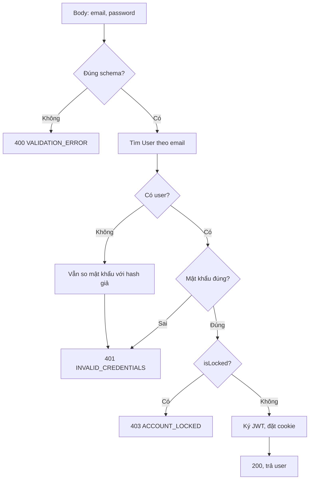
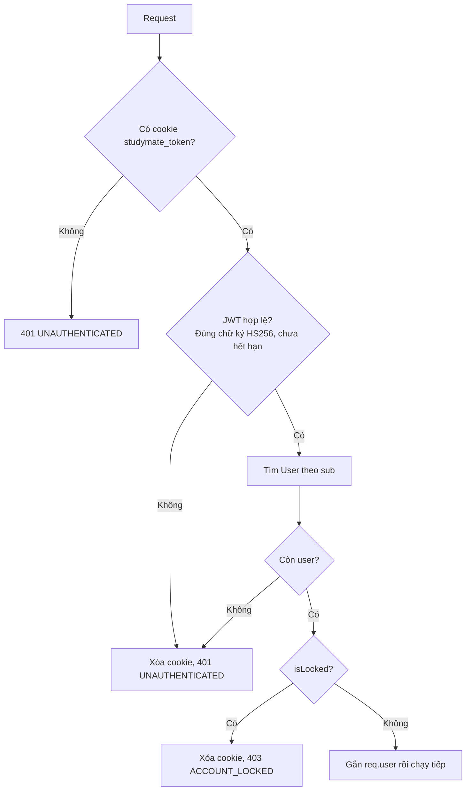

# Luồng đăng nhập và phân quyền

Trạng thái: **chờ duyệt** · Phần: `server/` · Soạn ngày 04/11/2026

Tài liệu mô tả đăng ký, đăng nhập, đăng xuất, đổi mật khẩu, hai middleware `requireAuth`/`requireRole` và cách tạo tài khoản Admin đầu tiên. Code phải bám đúng luồng này. Khi viết code mà thấy cần đổi luồng thì dừng lại, sửa tài liệu và xin duyệt lại (CLAUDE.md, nguyên tắc 2).

Ngoài phạm vi, sẽ có tài liệu riêng khi làm tới:

- Quyền theo khóa học (sinh viên phải thuộc lớp, giảng viên phải là người tạo khóa): luồng khóa học.
- Hạn mức AI (Q24): luồng hạn mức.
- API Admin khóa tài khoản và đổi quyền (tuần 7). Ở đây chỉ quy định hệ quả: thay đổi có hiệu lực ngay từ request kế tiếp.

## 1. Quyết định làm nền

| Chủ đề | Quyết định | Nguồn |
| --- | --- | --- |
| Nơi giữ token | JWT trong cookie httpOnly, `SameSite=Lax`, hạn 7 ngày, không có refresh token, chạy chung domain qua proxy | Q8 |
| Hash mật khẩu | bcrypt | `00-mo-ta-de-tai.md` mục 9 |
| Validate | Mọi body đều kiểm tra bằng Zod, schema đặt ở `shared/` | `00-mo-ta-de-tai.md` mục 9, Q4 |
| Kiểm tra người dùng | JWT chỉ chứa `userId`; mỗi request đọc lại `User` từ DB | Chốt 04/11/2026 |
| Đổi mật khẩu | Phiên ở máy khác vẫn dùng được đến khi token hết hạn (`ponytail`) | Chốt 04/11/2026 |
| Admin đầu tiên | `prisma db seed` đọc `ADMIN_EMAIL`, `ADMIN_PASSWORD` | Chốt 04/11/2026 |

## 2. API

Mọi đường dẫn có tiền tố `/api`; trình duyệt gọi qua proxy cùng domain (Vite khi dev, Vercel khi deploy).

| Method | Đường dẫn | Cần đăng nhập | Body | Thành công | Lỗi |
| --- | --- | --- | --- | --- | --- |
| POST | `/api/auth/register` | Không | `{ email, password }` | `201 { user }`, đặt cookie | 400, 409 |
| POST | `/api/auth/login` | Không | `{ email, password }` | `200 { user }`, đặt cookie | 400, 401, 403 |
| POST | `/api/auth/logout` | Không | | `204`, xóa cookie | |
| GET | `/api/auth/me` | Có | | `200 { user }` | 401, 403 |
| POST | `/api/auth/change-password` | Có | `{ currentPassword, newPassword }` | `204` | 400, 401, 403 |

`user` luôn có dạng `{ id, email, role }`. Không bao giờ trả `passwordHash` hay `isLocked`.

## 3. Định dạng dùng chung với client

Phần này nằm ở `shared/`, nên cần Nhật đồng ý trước khi viết code.

**Schema Zod trong `shared/src/auth.ts`:**

| Schema | Trường | Quy tắc |
| --- | --- | --- |
| `registerRequest` | `email`, `password` | Email theo mục 4.1; mật khẩu theo quy tắc "mật khẩu mới" ở mục 4.2 |
| `loginRequest` | `email`, `password` | Email theo mục 4.1; mật khẩu theo quy tắc "mật khẩu đã có" ở mục 4.2 |
| `changePasswordRequest` | `currentPassword`, `newPassword` | Lần lượt theo quy tắc "mật khẩu đã có" và "mật khẩu mới" |
| `authUser` | `id`, `email`, `role` | Dạng `user` ở mục 2 |

**Định dạng lỗi** do `lib/errors.ts` trả về; đề xuất đặt schema ở file mới `shared/src/errors.ts`:

```json
{
  "error": {
    "code": "VALIDATION_ERROR",
    "message": "Dữ liệu không hợp lệ",
    "fields": { "password": "Mật khẩu cần ít nhất 8 ký tự" }
  }
}
```

- `code`: chuỗi cố định để client rẽ nhánh. Client không so sánh `message`.
- `message`: tiếng Việt, hiện thẳng cho người dùng.
- `fields`: chỉ có ở lỗi 400 khi dữ liệu sai; khóa là tên trường, để React Hook Form hiện lỗi đúng ô.

| HTTP | `code` | Khi nào |
| --- | --- | --- |
| 400 | `VALIDATION_ERROR` | Body sai schema hoặc không phải JSON hợp lệ |
| 400 | `WRONG_CURRENT_PASSWORD` | Đổi mật khẩu mà mật khẩu hiện tại sai |
| 401 | `UNAUTHENTICATED` | Không có cookie, token sai hoặc hết hạn, user không còn |
| 401 | `INVALID_CREDENTIALS` | Đăng nhập sai email hoặc mật khẩu |
| 403 | `ACCOUNT_LOCKED` | Tài khoản bị khóa |
| 403 | `FORBIDDEN` | Đã đăng nhập nhưng không đủ quyền |
| 409 | `EMAIL_TAKEN` | Email đã được đăng ký |
| 500 | `INTERNAL` | Lỗi không lường trước; không trả stack trace |

Client rẽ nhánh theo `code`: `UNAUTHENTICATED` thì về trang đăng nhập; `ACCOUNT_LOCKED` thì báo bị khóa rồi về trang đăng nhập; các mã còn lại thì hiện lỗi tại chỗ.

## 4. Quy tắc chung

### 4.1. Email

Cắt khoảng trắng hai đầu, chuyển chữ thường, kiểm tra đúng định dạng, tối đa 254 ký tự. Cột `User.email` là `UNIQUE` có phân biệt hoa thường, nên phải chuẩn hóa trước cả khi lưu lẫn khi tìm. Làm trong schema Zod thì mọi nơi dùng chung một quy tắc.

### 4.2. Mật khẩu

- **Chuẩn hóa Unicode NFKC** trước khi kiểm tra độ dài, hash hay so sánh. Cùng một chữ có dấu có thể được bộ gõ ở các máy khác nhau sinh ra theo hai cách mã hóa (dựng sẵn hoặc tổ hợp). Không chuẩn hóa thì người dùng gõ đúng mật khẩu ở máy khác vẫn bị báo sai. NIST SP 800-63B khuyến nghị chuẩn hóa NFKC hoặc NFKD cho mật khẩu có ký tự Unicode.
- **Mật khẩu mới** (đăng ký, đổi mật khẩu): ít nhất 8 ký tự, **tối đa 72 byte** UTF-8. bcrypt chỉ dùng 72 byte đầu và bỏ phần còn lại mà không báo lỗi. Một chữ tiếng Việt có dấu chiếm 2–3 byte, nên giới hạn phải tính theo byte chứ không theo số ký tự.
- **Mật khẩu đã có** (đăng nhập, mật khẩu hiện tại): chỉ cần không rỗng và tối đa 72 byte. Không áp độ dài tối thiểu, để sau này đổi quy tắc thì tài khoản cũ vẫn đăng nhập được.
- bcrypt cost = 10, mức tối thiểu OWASP khuyến nghị. Mỗi lần tăng cost thêm 1 thì thời gian hash tăng gấp đôi, mà Render free có CPU yếu. Đặt thành hằng số để dễ chỉnh.

### 4.3. JWT

- Thuật toán HS256, khóa `JWT_SECRET` dài ít nhất 32 ký tự; nên sinh 32 byte ngẫu nhiên (64 ký tự hex) như `INTERNAL_KEY`. RFC 7518 mục 3.2 yêu cầu khóa HS256 dài ít nhất 256 bit. Thiếu khóa hoặc khóa quá ngắn thì server dừng ngay lúc khởi động, giống cách `ai/` xử lý `INTERNAL_KEY`.
- Payload gồm `sub` (là `User.id`), `iat`, và `exp` = `iat` + 7 ngày. Không chứa role hay email, vì hai thông tin này được đọc từ DB ở mỗi request.
- Khi kiểm tra chỉ chấp nhận đúng HS256, để chặn kiểu tấn công sửa trường `alg` của token (ví dụ `alg: none`).

### 4.4. Cookie

| Thuộc tính | Giá trị | Vì sao |
| --- | --- | --- |
| Tên | `studymate_token` | Cookie không tách theo cổng (RFC 6265 mục 8.5): mọi app chạy trên `localhost` dùng chung cookie, nên cần tên riêng để khỏi đụng nhau |
| `HttpOnly` | Có | JavaScript trên trang không đọc được token |
| `SameSite` | `Lax` | Trình duyệt không gửi cookie kèm request POST xuất phát từ trang khác, nên không cần CSRF token |
| `Secure` | Chỉ khi `NODE_ENV=production` | Khi dev, trang chạy trên `http://localhost` |
| `Path` | `/` | |
| `Max-Age` | 7 ngày | Trùng hạn JWT |
| `Domain` | Không đặt | Cookie gắn với domain trình duyệt đang mở; `/api/*` đi qua proxy cùng domain |

Hai quy tắc để `SameSite=Lax` đủ an toàn:

- Không route `GET` nào được thay đổi dữ liệu, vì `Lax` vẫn gửi cookie khi người dùng bấm link từ trang khác.
- Không bật CORS cho phép gửi kèm cookie. Trình duyệt luôn gọi cùng domain qua proxy.

Khi xóa cookie phải dùng đúng `Path`, `SameSite`, `Secure` như lúc đặt; sai một thuộc tính thì trình duyệt coi là cookie khác và không xóa.

## 5. Các luồng

### 5.1. Đăng ký: `POST /api/auth/register`

| # | Input | Xử lý | Output hoặc lỗi |
| --- | --- | --- | --- |
| 1 | Body JSON | Parse bằng `registerRequest`: chuẩn hóa email, NFKC mật khẩu, kiểm tra độ dài | Sai: 400 `VALIDATION_ERROR` kèm `fields` |
| 2 | `password` | Hash bcrypt, cost 10 | `passwordHash` |
| 3 | `email`, `passwordHash` | `INSERT` vào `User` với `role = STUDENT` | Trùng email (Prisma báo `P2002`): 409 `EMAIL_TAKEN` |
| 4 | `user.id` | Ký JWT, đặt cookie | |
| 5 | | | `201 { user }`; người dùng đã đăng nhập luôn |

- Không chạy `SELECT` để xem email đã có chưa rồi mới `INSERT`: hai request đăng ký cùng lúc có thể cùng thấy "chưa có". Để ràng buộc `UNIQUE` của DB quyết định thì chỉ một request thành công, request kia nhận 409.
- Body gửi kèm `role` cũng vô ích: Zod bỏ các trường lạ, nên không ai tự đăng ký làm Admin được.

### 5.2. Đăng nhập: `POST /api/auth/login`



| # | Input | Xử lý | Output hoặc lỗi |
| --- | --- | --- | --- |
| 1 | Body JSON | Parse bằng `loginRequest` | Sai: 400 |
| 2 | `email` | Tìm `User` theo email | Không có: sang bước 3a |
| 3a | `password` | Vẫn chạy so sánh bcrypt với một hash giả (tạo sẵn, cùng cost), rồi báo lỗi | 401 `INVALID_CREDENTIALS` |
| 3b | `password`, `passwordHash` | So sánh bcrypt | Sai: 401 `INVALID_CREDENTIALS` |
| 4 | `isLocked` | Chỉ kiểm tra khi mật khẩu đã đúng | Bị khóa: 403 `ACCOUNT_LOCKED` |
| 5 | `user.id` | Ký JWT, đặt cookie | `200 { user }` |

- Sai email hay sai mật khẩu đều nhận cùng một lỗi, sau cùng một khoảng thời gian (nhờ bước 3a). Nhờ vậy không ai dò được email nào đã đăng ký bằng cách thử đăng nhập. Màn đăng ký vẫn phải báo "email đã được dùng"; chỗ này không tránh được và nhóm chấp nhận.
- Chỉ báo "tài khoản bị khóa" khi mật khẩu đúng, để người ngoài không biết được tài khoản nào đang bị khóa.

### 5.3. Middleware `requireAuth`



| # | Input | Xử lý | Output hoặc lỗi |
| --- | --- | --- | --- |
| 1 | Header `Cookie` | Lấy `studymate_token` | Không có: 401 |
| 2 | Token | Kiểm tra chữ ký và `exp` | Sai hoặc hết hạn: xóa cookie, 401 |
| 3 | `sub` | Đọc `id, email, role, isLocked` của `User` theo khóa chính | Không còn user: xóa cookie, 401 |
| 4 | `isLocked` | | Bị khóa: xóa cookie, 403 `ACCOUNT_LOCKED` |
| 5 | | Gắn `req.user = { id, email, role }` | Route chạy tiếp |

Nhờ bước 3 mà Admin khóa tài khoản hay đổi quyền đều có hiệu lực ngay ở request kế tiếp; cái giá là mỗi request thêm một truy vấn theo khóa chính. Token không được gia hạn tự động (xem mục 9).

### 5.4. Middleware `requireRole(...roles)`

Đặt sau `requireAuth`, ví dụ `requireAuth, requireRole("ADMIN")`. Nếu `req.user.role` nằm trong `roles` thì chạy tiếp, không thì trả 403 `FORBIDDEN`.

`requireRole` chỉ xét vai trò trên toàn hệ thống. Quyền gắn với từng khóa học được kiểm tra trong module khóa học.

### 5.5. Đăng xuất: `POST /api/auth/logout`

Xóa cookie, trả 204. Không cần đăng nhập và gọi nhiều lần vẫn trả 204, để client luôn đăng xuất được kể cả khi token đã hết hạn. Server không thu hồi token (xem mục 9). Nhưng cookie là httpOnly và đã bị xóa khỏi trình duyệt, nên chỉ ai đã sao chép được token từ trước mới dùng tiếp được.

### 5.6. Người đang đăng nhập: `GET /api/auth/me`

Đi qua `requireAuth`, trả `200 { user }`. Client gọi khi mở app để biết đã đăng nhập chưa và hiện menu theo `role`.

### 5.7. Đổi mật khẩu: `POST /api/auth/change-password`

| # | Input | Xử lý | Output hoặc lỗi |
| --- | --- | --- | --- |
| 1 | Cookie | `requireAuth` | 401 hoặc 403 như mục 5.3 |
| 2 | Body JSON | Parse bằng `changePasswordRequest` | Sai: 400 |
| 3 | `req.user.id` | Đọc `passwordHash` | |
| 4 | `currentPassword` | So sánh bcrypt | Sai: 400 `WRONG_CURRENT_PASSWORD`, lỗi gắn vào `fields.currentPassword` |
| 5 | `newPassword` | Hash rồi cập nhật `User.passwordHash` | `204` |

- Mật khẩu hiện tại sai thì trả **400, không trả 401**. Client hiểu 401 là phiên đăng nhập đã hết và sẽ đẩy người dùng về trang đăng nhập.
- Cookie hiện tại giữ nguyên. Phiên ở máy khác vẫn dùng được đến khi token hết hạn (đã chốt, xem mục 9).

### 5.8. Tạo Admin đầu tiên: `npx prisma db seed`

| # | Input | Xử lý | Output hoặc lỗi |
| --- | --- | --- | --- |
| 1 | `ADMIN_EMAIL`, `ADMIN_PASSWORD` trong `server/.env` | Kiểm tra bằng cùng quy tắc ở mục 4.1 và 4.2 | Thiếu hoặc sai: in lỗi, thoát với mã khác 0, không ghi gì |
| 2 | Email, mật khẩu đã hash | `upsert` theo email. Chưa có thì tạo với `role = ADMIN`. Đã có thì chỉ đặt `role = ADMIN`, `isLocked = false`, **không đổi mật khẩu** | In ra đã tạo mới hay đã cấp quyền |

- File `server/prisma/seed.ts`, khai báo trong `prisma.config.ts`: `migrations.seed = "tsx prisma/seed.ts"`.
- Prisma 7 không còn tự chạy seed sau `migrate dev` hay `migrate reset`; phải chạy `npx prisma db seed` trong `server/`.
- Chạy lại bao nhiêu lần cũng không sinh bản ghi trùng. Bước 2 không ghi đè mật khẩu, để lỡ chạy lại seed cũng không mất mật khẩu mà Admin đã đổi.
- Cách chạy seed trên môi trường deploy sẽ chốt ở tuần deploy.

## 6. Dữ liệu đọc và ghi

| Luồng | Đọc | Ghi |
| --- | --- | --- |
| Đăng ký | | `User`: thêm một dòng |
| Đăng nhập | `User` theo `email` | |
| `requireAuth` | `User` theo `id` | |
| Đổi mật khẩu | `User.passwordHash` | `User.passwordHash` |
| Seed | `User` theo `email` | `User`: thêm mới, hoặc sửa `role` và `isLocked` |

Không thêm bảng hay cột; `schema.prisma` giữ nguyên. Các truy vấn đọc đều dùng chỉ mục có sẵn (khóa chính `id`, chỉ mục duy nhất `User_email_key`). Phía trình duyệt chỉ lưu đúng một cookie.

## 7. Trường hợp biên

| Tình huống | Xử lý |
| --- | --- |
| Email viết hoa hoặc dính khoảng trắng | Chuẩn hóa theo mục 4.1, coi là cùng một tài khoản |
| Hai request đăng ký cùng email, cùng lúc | Ràng buộc `UNIQUE` của DB: một request nhận 201, request kia nhận 409 |
| Mật khẩu dài quá 72 byte | 400, không để bcrypt âm thầm cắt bớt |
| Cùng một mật khẩu gõ bằng hai bộ gõ khác nhau | Chuẩn hóa NFKC nên vẫn khớp. Riêng khác biệt về vị trí dấu thanh ("hoá" và "hóa") là hai chuỗi khác nhau thật, không gộp |
| Body đăng ký có `role: "ADMIN"` | Zod bỏ trường lạ; luôn tạo `STUDENT` |
| Body không phải JSON, hoặc lớn hơn 100 KB (giới hạn mặc định của `express.json`) | 400 `VALIDATION_ERROR` qua middleware lỗi |
| Đăng nhập bằng email không tồn tại | Vẫn so với hash giả, trả 401 giống hệt sai mật khẩu |
| Tài khoản bị khóa đăng nhập | Mật khẩu đúng: 403 `ACCOUNT_LOCKED`. Mật khẩu sai: 401 như bình thường |
| Bị khóa khi đang đăng nhập | Request kế tiếp: xóa cookie, 403 `ACCOUNT_LOCKED` |
| Admin đổi role của một người | Có hiệu lực từ request kế tiếp, không cần đăng nhập lại |
| User đã bị xóa nhưng còn token | Xóa cookie, 401 |
| Token bị sửa, sai chữ ký, dùng `alg` khác HS256, hoặc hết hạn | Xóa cookie, 401 |
| Đổi `JWT_SECRET` | Mọi token cũ mất hiệu lực, tất cả phải đăng nhập lại. Dùng cách này khi nghi khóa bị lộ |
| Thiếu `JWT_SECRET` hoặc ngắn hơn 32 ký tự | Server không khởi động, in lỗi rõ ràng |
| Gọi đăng xuất khi chưa đăng nhập | 204 |
| Đổi mật khẩu nhưng nhập sai mật khẩu hiện tại | 400, lỗi hiện ở ô `currentPassword` |
| Đăng ký thành công nhưng mạng rớt trước khi client nhận phản hồi | Client thử lại sẽ nhận 409; client gợi ý người dùng đăng nhập |
| Chạy seed hai lần | Không tạo trùng; lần sau chỉ đảm bảo `role = ADMIN` |
| `ADMIN_EMAIL` trùng một tài khoản sinh viên đã đăng ký | Seed nâng tài khoản đó lên Admin, giữ nguyên mật khẩu |

## 8. Xử lý lỗi và chạy lại

- Mọi luồng ở đây là request đồng bộ, không có việc chạy nền, nên server không cần cơ chế chạy lại. Gặp lỗi thì người dùng thử lại.
- Mỗi luồng ghi tối đa một câu lệnh (`INSERT`, `UPDATE` hoặc `upsert`), nên lỗi giữa chừng không để lại dữ liệu ghi dở.
- Middleware lỗi (`lib/errors.ts`) đưa mọi lỗi về định dạng ở mục 3: lỗi Zod thành 400; lỗi nghiệp vụ được ném ra kèm `code` và HTTP status; mọi lỗi khác (kể cả mất kết nối DB) thành 500 `INTERNAL`. Server ghi log đầy đủ nhưng không trả stack trace cho client.
- Express 5 tự chuyển lỗi của handler `async` sang middleware lỗi, nên không cần bọc `try/catch` trong từng route hay dùng thư viện `express-async-errors`.

## 9. Giới hạn có chủ ý (`ponytail`)

Mỗi giới hạn dưới đây sẽ có comment `ponytail:` ngay chỗ tương ứng trong code.

| Giới hạn | Hệ quả | Cách nâng cấp |
| --- | --- | --- |
| Đổi mật khẩu không đăng xuất các phiên khác | Token cũ ở máy khác dùng được thêm tối đa 7 ngày | Thêm cột `User.passwordChangedAt`; `requireAuth` từ chối token có `iat` sớm hơn cột này (cần sửa schema) |
| Đăng xuất không thu hồi token | Ai đã sao chép được token vẫn dùng được đến khi hết hạn | Như dòng trên, hoặc lưu danh sách phiên trong DB |
| Không gia hạn tự động | Người đang dùng vẫn bị đăng xuất đúng 7 ngày sau lần đăng nhập | Cấp token mới khi token còn chưa đến một nửa thời hạn |
| Chưa giới hạn số lần đăng nhập sai | Có thể dò mật khẩu bằng cách thử liên tục; bcrypt chỉ làm chậm chứ không chặn | Giới hạn theo IP ở `/api/auth/login` (cần thêm dependency, và cấu hình `trust proxy` khi chạy sau proxy) |
| Không xác minh email, chưa có quên mật khẩu | Đăng ký bằng email không có thật vẫn được; quên mật khẩu thì chưa có cách tự lấy lại | Gửi email xác minh và email đặt lại mật khẩu (cần dịch vụ gửi mail) |

## 10. Kiểm thử

Theo Q6: Vitest + Supertest, chạy trên PostgreSQL thật trong Docker. Mỗi dòng ở mục 7 có ít nhất một test. Các nhóm chính:

1. **Đăng ký:** trả 201 và cookie có `HttpOnly`, `SameSite=Lax`; gửi kèm `role: "ADMIN"` vẫn thành `STUDENT`; trùng email, kể cả khác hoa thường, trả 409; mật khẩu 24 chữ "ệ" (72 byte) được chấp nhận, 25 chữ (75 byte) bị 400.
2. **Đăng nhập:** đúng thì 200 kèm cookie; sai mật khẩu và email lạ trả cùng 401 `INVALID_CREDENTIALS`; bị khóa mà đúng mật khẩu thì 403, sai mật khẩu thì 401; đăng ký bằng mật khẩu dạng dựng sẵn (NFC) rồi đăng nhập bằng dạng tổ hợp (NFD) vẫn được.
3. **`requireAuth`:** không có cookie thì 401; sửa một ký tự của token thì 401 và cookie bị xóa; token hết hạn hoặc `alg: none` thì 401; bị khóa sau khi đăng nhập thì 403; đổi role trong DB thì `/me` trả role mới ngay.
4. **`requireRole`:** STUDENT gọi route chỉ dành cho ADMIN thì nhận 403 `FORBIDDEN`.
5. **Đổi mật khẩu:** sai mật khẩu hiện tại thì 400 (không phải 401); đúng thì 204, sau đó đăng nhập bằng mật khẩu mới được, mật khẩu cũ bị 401.
6. **Seed:** chạy hai lần vẫn chỉ có một Admin; email đã là sinh viên thì thành Admin và giữ mật khẩu.

## 11. Chuẩn bị cho bước viết code

**File sẽ thêm hoặc sửa:**

| File | Nội dung |
| --- | --- |
| `server/src/lib/auth.ts` | Hash và so mật khẩu, ký và kiểm tra JWT, đặt và xóa cookie, `requireAuth`, `requireRole` |
| `server/src/lib/errors.ts` | Lớp lỗi có `code` và middleware lỗi (mục 3, mục 8) |
| `server/src/modules/auth/routes.ts` | 5 endpoint ở mục 2 |
| `server/src/index.ts` | Gắn phần đọc cookie, router `/api/auth`, middleware lỗi |
| `server/prisma/seed.ts`, `server/prisma.config.ts` | Seed Admin (mục 5.8) |
| `server/.env.example` | `JWT_SECRET`, `ADMIN_EMAIL`, `ADMIN_PASSWORD`, `NODE_ENV` |
| `shared/src/auth.ts`, `shared/src/errors.ts`, `shared/src/index.ts` | Schema ở mục 3; **cần Nhật đồng ý** |

**Việc cần chọn ở bước viết code**, mỗi việc sẽ có 2–3 phương án để chọn:

- Thư viện hash bcrypt.
- Thư viện ký và kiểm tra JWT.
- Cách đọc cookie từ request.
- Cách dựng test: thêm Vitest và Supertest (đã chốt ở Q6), tách `src/app.ts` khỏi `index.ts` để test gọi app mà không mở cổng, và thêm PostgreSQL vào CI.

## 12. Cần xem khi duyệt

Những điểm dưới đây chưa có trong các quyết định đã chốt, nên tài liệu đang tạm dùng một mặc định. Đồng ý thì giữ, không thì sửa trước khi viết code.

1. **Tự đăng nhập sau khi đăng ký** (mục 5.1). Cách khác: đăng ký xong bắt đăng nhập lại.
2. **Quy tắc mật khẩu:** chỉ yêu cầu ít nhất 8 ký tự, không bắt buộc có chữ hoa, chữ số hay ký tự đặc biệt. NIST SP 800-63B khuyên không ép các quy tắc tổ hợp kiểu này.
3. **Họ tên:** đăng ký chỉ có email và mật khẩu, vì bảng `User` chưa có cột tên (đúng mục 8.1 của tài liệu đề tài). Nếu muốn hiện họ tên, ví dụ ở danh sách thành viên lớp, thì phải thêm cột, tức sửa schema và cần cả nhóm đồng ý. Nên quyết ngay, vì form đăng ký của Nhật phụ thuộc vào điểm này.
4. **Làm sớm `PATCH /api/admin/users/:id`** (Admin đổi `role` và `isLocked`) ngay trong nhánh này? Tuần này đã cần tài khoản Giảng viên để thử CRUD khóa học, trong khi API Admin dự kiến làm ở tuần 7. Nếu không làm sớm thì tạm đổi role bằng Prisma Studio (`npx prisma studio`).
5. **Định dạng lỗi ở mục 3** và file mới `shared/src/errors.ts`. File này chưa có trong cấu trúc ở `01-kien-truc-du-an.md` mục 3, nên cần bạn và Nhật đồng ý. Nếu đồng ý thì cập nhật mục 3 của file đó trước khi viết code.
