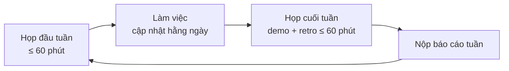
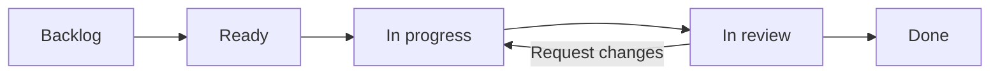

# Quy trình làm việc chính thức – StudyMate

Phiên bản 1.0 · 24/10/2026 · Áp dụng cho cả 3 thành viên từ tuần 1 đến hết đồ án.

Tài liệu này quy định **cách nhóm làm việc**: lên kế hoạch mỗi tuần, làm một ticket từ đầu đến cuối, review, thay đổi database, dùng AI và báo cáo. Quy tắc Git chi tiết nằm trong [CONTRIBUTING.md](../CONTRIBUTING.md); tài liệu này chỉ dẫn sang, không lặp lại.

Mỗi quy tắc đều có nhãn cho biết nó đến từ đâu:
- **[Nguồn N]**: lấy từ tài liệu chính thức hoặc thực hành được công bố, xem danh sách ở cuối.
- **[Nhóm quy ước]**: nhóm tự đặt cho vừa đồ án, không có nguồn bên ngoài. Có thể sửa trong buổi retro.

---

## 1. Ba nguyên tắc nền

| Nguyên tắc | Nghĩa là | Nguồn |
| --- | --- | --- |
| **`main` luôn chạy được** | Mọi thay đổi đi qua nhánh riêng và Pull Request (PR), CI phải xanh trước khi merge | [1], [9] |
| **Làm theo vòng lặp 1 tuần** | Đầu tuần lên kế hoạch, cuối tuần demo + rút kinh nghiệm + báo cáo | [3] |
| **Không có bằng chứng thì chưa xong** | Mỗi thay đổi phải có cách kiểm chứng (test, build, chạy thử) và bằng chứng nằm trong PR | [3], [12] |

---

## 2. Vai trò

| Vai trò | Người đảm nhận | Trách nhiệm | Nguồn |
| --- | --- | --- | --- |
| AI | Mạnh | `ai/`: ingest, hybrid search, chat RAG, sinh quiz, đánh giá | [Nhóm quy ước] theo [phân công](00-mo-ta-de-tai.md#11-kế-hoạch-và-phân-công) |
| Backend | Dũng | `server/`: auth, quyền, CRUD, upload, chuyển tiếp stream, hạn mức, Docker Compose, deploy | như trên |
| Frontend | Nhật | `client/`: toàn bộ giao diện | như trên |
| **Người điều phối tuần** | Luân phiên mỗi tuần: Mạnh → Dũng → Nhật | Chủ trì họp đầu/cuối tuần, tổng hợp báo cáo tuần, nhắc PR chờ review | [Nhóm quy ước] |
| **Chủ repo** | [Tên], một người cố định | Quản lý cài đặt GitHub, mời thành viên, quản lý secret khi deploy | [Nhóm quy ước] |

Mỗi người **chỉ sửa trong thư mục của mình**. Một chức năng cần nhiều tầng thì mỗi người làm phần của mình rồi ghép lại qua hợp đồng API. Phần dùng chung (`shared/`, `schema.prisma`, API nội bộ Express ↔ Python) phải được những người bị ảnh hưởng cùng đồng ý. [Nhóm quy ước]

---

## 3. Giai đoạn 0: khởi động (làm một lần, trong tuần 1)

Hiện trạng: dự án đã có khung code, chưa có commit nào, chưa có repo trên GitHub. Làm lần lượt:

### 3.1. Chốt quyết định
- [ ] Cả nhóm đọc [mô tả đề tài](00-mo-ta-de-tai.md) và chốt các mục ở phần 14 (nhà cung cấp AI, nơi lưu file, tham số [X], phân công chính thức). [Nhóm quy ước]
- [ ] Chọn thư viện test cho server và client. Bước này cần có trước khi áp dụng Definition of Done ở mục 5.3. [Nhóm quy ước]

### 3.2. Repo và GitHub (chủ repo làm)
- [ ] Tạo repo trên GitHub, commit lần đầu khung dự án hiện có, push lên `main`.
- [ ] Mời 2 thành viên còn lại với quyền *Write*.
- [ ] **Bảo vệ nhánh `main`** bằng ruleset gồm 3 rule: *Require a pull request before merging* (1 approval), *Require status checks to pass before merging* (chọn job CI), *Block force pushes*. [Nguồn 10]
  - ⚠ Ruleset **miễn phí cho repo public**; với **repo private** thì cần gói trả phí (GitHub Pro / Team / Enterprise). [Nguồn 10]. Nếu repo phải để private mà không có gói trả phí, nhóm tự giữ kỷ luật theo [CONTRIBUTING.md](../CONTRIBUTING.md) và người điều phối kiểm tra lịch sử `main` mỗi tuần. [Nhóm quy ước]
- [ ] Chỉ bật kiểu merge **Squash and merge**. [Nguồn 11]
- [ ] Tạo **GitHub Projects** dạng board, thêm trường *Iteration* độ dài 1 tuần. Board có các cột theo mục 5.1. [Nguồn 13]

### 3.3. Máy của từng thành viên
- [ ] Cài Node 24, Docker Desktop, Git; clone repo; làm theo phần "Chạy local" trong [README](../README.md).
- [ ] Cấu hình `git config user.name` và `user.email` trùng với email tài khoản GitHub (để thống kê đóng góp được tính đúng). [Nhóm quy ước]
- [ ] Tạo `server/.env` từ `server/.env.example`. **Không bao giờ commit `.env`.** [Nguồn 7]

### 3.4. Môi trường AI (nếu dùng Claude Code)
- [ ] Tạo file `CLAUDE.md` ở gốc repo: lệnh chạy/kiểm tra, quy ước đặt tên nhánh/PR, các lưu ý riêng của dự án (ví dụ: ghim Prisma 7.10.1). Viết ngắn gọn và commit vào git để cả nhóm dùng chung. [Nguồn 12]
- [ ] Chạy `/setup-matt-pocock-skills` một lần, chọn GitHub Issues làm nơi quản lý ticket. [Nguồn 14]

---

## 4. Chu kỳ một tuần

Mỗi tuần là một vòng lặp có độ dài cố định, dựa trên các sự kiện của Scrum và thu nhỏ cho nhóm 3 người. Scrum quy định sprint dài tối đa 1 tháng và mỗi sự kiện có giới hạn thời gian; mốc thời gian cụ thể dưới đây là nhóm tự chọn. [Nguồn 3]



| Sự kiện | Khi nào | Làm gì | Đầu ra | Nguồn |
| --- | --- | --- | --- | --- |
| **Họp đầu tuần** (Sprint Planning) | [Ngày], ngay sau buổi báo cáo với giảng viên | Chốt mục tiêu tuần (1 câu); chọn ticket từ Backlog, mỗi người nhận việc; chia ticket lớn thành ticket nhỏ | Iteration mới trên board, mỗi ticket có người nhận | [3] |
| **Cập nhật hằng ngày** (Daily Scrum) | Mỗi tối, nhắn trong nhóm chat, không cần họp | 3 ý: hôm qua làm gì, hôm nay làm gì, đang bị vướng gì | Ai bị chặn thì được hỗ trợ ngay trong ngày | [3] (Scrum gốc: họp 15 phút; nhóm đổi thành nhắn tin) |
| **Họp cuối tuần** (Review + Retrospective) | [Ngày] | Demo trên `main` những gì đã merge; so với mục tiêu tuần; nêu 1 điều nên giữ, 1 điều nên đổi | Danh sách thay đổi quy trình cho tuần sau | [3] |
| **Báo cáo tuần** | Trước buổi báo cáo với giảng viên | Người điều phối tổng hợp theo mẫu ở mục 10 | File `docs/bao-cao-tuan/tuan-N.md` | [Nhóm quy ước] |

Theo Scrum, việc chưa đạt Definition of Done thì **không được đưa ra demo**. [Nguồn 3]

---

## 5. Vòng đời một ticket

### 5.1. Các trạng thái



| Trạng thái | Nghĩa là | Ai chuyển |
| --- | --- | --- |
| Backlog | Ý tưởng hoặc việc chưa rõ | Bất kỳ ai |
| Ready | Đạt Definition of Ready (mục 5.2) | Người điều phối, trong họp đầu tuần |
| In progress | Đã có người nhận, đã tạo nhánh | Người làm |
| In review | Đã mở PR, CI đang chạy hoặc đã xanh | Người làm |
| Done | PR đã merge vào `main` và đạt Definition of Done | Tự động khi merge nếu PR có `Closes #N` [Nguồn 8] |

[Nhóm quy ước]. Riêng phần tự động đóng issue khi merge là theo [Nguồn 8].

### 5.2. Definition of Ready: ticket được nhận khi
- [ ] Có mô tả **hành vi mong muốn** nhìn từ phía người dùng, kèm tiêu chí chấp nhận kiểm tra được.
- [ ] Ghi rõ ticket phải chờ ticket nào làm xong trước (nếu có).
- [ ] Đủ nhỏ để xong trong **1–3 ngày** và PR dưới khoảng 400 dòng thay đổi. Google khuyến nghị khoảng 100 dòng là hợp lý và 1000 dòng thường là quá lớn. [Nguồn 4]
- [ ] Nếu đụng tới database thì ghi rõ thay đổi bảng nào.

[Nhóm quy ước], riêng giới hạn kích thước theo [Nguồn 4].

### 5.3. Definition of Done: ticket xong khi
- [ ] Code đã merge vào `main` qua PR có 1 approval. [Nguồn 1], [Nguồn 10]
- [ ] CI xanh (`npm run lint`, `npm run build`, và test khi đã có). [Nguồn 9]
- [ ] Logic có nhánh rẽ hoặc dễ sai (quyền truy cập, chấm điểm, tìm kiếm) có test tự động. [Nguồn 12]
- [ ] Nếu đổi schema: migration đã được commit cùng PR. [Nguồn 6]
- [ ] Không có secret trong code hoặc lịch sử commit. [Nguồn 7]
- [ ] Người review đã chạy thử luồng chính trên máy mình (với tính năng có giao diện).
- [ ] Ticket ở trạng thái Done trên board.

Scrum quy định nhóm phải có Definition of Done; nội dung cụ thể ở trên là nhóm tự đặt. [Nguồn 3]

---

## 6. Quy trình làm một ticket (từng bước)

Theo GitHub flow [Nguồn 1], kết hợp quy trình "tìm hiểu → lên kế hoạch → code → commit" của Claude Code [Nguồn 12].

| Bước | Làm gì | Lệnh / công cụ | Nguồn |
| --- | --- | --- | --- |
| 1. Nhận việc | Gán mình vào ticket, chuyển sang In progress | GitHub Projects | [13] |
| 2. Tạo nhánh | Từ `main` mới nhất, đặt tên theo [CONTRIBUTING §2](../CONTRIBUTING.md#2-đặt-tên-nhánh) | `git switch main && git pull && git switch -c feat/...` | [1] |
| 3. Tìm hiểu và lên kế hoạch | Đọc code liên quan. Ticket đụng nhiều file hoặc chưa rõ cách làm thì lập kế hoạch trước; sửa nhỏ, mô tả được trong 1 câu thì bỏ qua bước này | Claude Code plan mode (`Shift+Tab`); tính năng lớn dùng `/grill-with-docs` | [12], [14] |
| 4. Viết code kèm cách kiểm chứng | Logic quan trọng: viết test trước, rồi code cho test qua | `/tdd` | [12], [14] |
| 5. Commit thường xuyên | Mỗi commit là một thay đổi có nghĩa, message theo Conventional Commits | `git commit -m "feat(chat): ..."` | [2] |
| 6. Tự kiểm tra | Chạy đúng các lệnh CI sẽ chạy; tự đọc lại diff của mình | `npm run lint && npm run build` | [9] |
| 7. Mở PR | Điền mẫu PR; ghi `Closes #N`; gán 1 người review; chuyển ticket sang In review | `git push -u origin <nhánh>` | [1], [8], [15] |
| 8. Xử lý review | Sửa theo góp ý bằng commit mới trên cùng nhánh; PR tự cập nhật | | [1] |
| 9. Merge | Khi đủ approval và CI xanh: Squash and merge, xóa nhánh | Nút trên GitHub | [1], [11] |
| 10. Dọn dẹp | Về `main`, kéo code mới; `/clear` phiên Claude trước khi nhận ticket mới | `git switch main && git pull` | [12] |

Cập nhật nhánh khi `main` đã thay đổi: xem [CONTRIBUTING §4](../CONTRIBUTING.md#cập-nhật-nhánh-khi-main-đã-thay-đổi). Khi cần force-push lên nhánh của chính mình, chỉ dùng `--force-with-lease`: lệnh này từ chối ghi đè nếu trên remote đã có commit mới mà bạn chưa kéo về. [Nguồn 16]

---

## 7. Code review

| Quy tắc | Nguồn |
| --- | --- |
| Phản hồi review **trong tối đa 1 ngày làm việc**; nếu không đang tập trung làm việc khác thì review ngay khi nhận được | [5] |
| PR nhỏ được review nhanh hơn, kỹ hơn, ít lỗi hơn. Gặp PR quá lớn, người review có quyền yêu cầu chia nhỏ | [4] |
| Người review kiểm tra: đúng yêu cầu của ticket, có test cho phần logic, không lộ secret, migration đi kèm nếu đổi schema | [Nhóm quy ước] |
| Lỗi bắt buộc phải sửa thì chọn *Request changes*; góp ý không bắt buộc thì ghi tiền tố `nit:` | [Nhóm quy ước] |
| Có thể nhờ AI review thêm trong một phiên mới (để nó không thiên vị code vừa viết): `/mattpocock-skills:code-review` hoặc subagent. **AI review không thay được review của thành viên** | [12], [14] |

---

## 8. Thay đổi database (Prisma 7)

| Bước | Làm gì | Nguồn |
| --- | --- | --- |
| 1 | Báo trong nhóm chat trước khi sửa `schema.prisma`, để tránh hai người cùng sửa | [Nhóm quy ước] |
| 2 | Sửa schema, rồi chạy `npm run db:migrate -w server` (tức `prisma migrate dev`) để sinh migration | [6] |
| 3 | Commit **cả** `schema.prisma` **và** thư mục `prisma/migrations` (kể cả `migration_lock.toml`). Chỉ commit schema là không đủ | [6] |
| 4 | Khi kéo code mới có migration của người khác: chạy lại `prisma migrate dev`. Lệnh này áp migration của đồng đội rồi mới tạo migration của mình. Ở Prisma 7, lệnh này **không** tự chạy `prisma generate`, nên chạy thêm generate | [6] |
| 5 | **Không bao giờ** chạy `migrate dev` trên database production. Production và CI dùng `prisma migrate deploy`, chạy tự động trong pipeline | [17] |

---

## 9. Bí mật và cấu hình

| Quy tắc | Nguồn |
| --- | --- |
| Mọi thông tin bí mật (API key, mật khẩu DB, JWT secret) đặt trong **biến môi trường**, không ghi trong code. Phép thử: repo có thể công khai bất cứ lúc nào mà không lộ thông tin bí mật nào | [7] |
| `server/.env.example` chỉ chứa giá trị mẫu; khi thêm biến mới thì cập nhật file này trong cùng PR | [Nhóm quy ước] |
| Lỡ commit secret: **việc đầu tiên là thu hồi hoặc đổi key đó**, sau đó mới tính đến chuyện dọn lịch sử git | [18] |
| Không dán API key hay dữ liệu cá nhân vào prompt của AI | [Nhóm quy ước] |

---

## 10. Dùng AI (Claude Code) trong dự án

| Quy tắc | Nguồn |
| --- | --- |
| **Code do AI viết vẫn là code của bạn**: bạn đọc hiểu, chạy thử, và chịu trách nhiệm khi review và bảo vệ đồ án | [Nhóm quy ước] |
| Luôn cho AI một cách kiểm chứng (test, build, ảnh chụp màn hình) và yêu cầu nó đưa ra bằng chứng thay vì chỉ nói "đã xong" | [12] |
| Việc lớn: lập kế hoạch trước (plan mode, hoặc để AI phỏng vấn bạn rồi viết spec); việc nhỏ: làm thẳng | [12] |
| `/clear` giữa các việc không liên quan; nếu đã sửa AI hơn 2 lần cho cùng một lỗi thì `/clear` và viết lại prompt rõ hơn | [12] |
| `CLAUDE.md` của dự án giữ ngắn gọn, chỉ ghi những gì AI không tự suy ra được từ code; commit vào git | [12] |
| Luồng skill gợi ý: `/grill-with-docs` → `/to-spec` → `/to-tickets` → `/implement` → `/pr`. Xem [bảng tra skill](skills-mattpocock.md) | [14] |
| Báo cáo đồ án ghi rõ phần nào có dùng AI hỗ trợ, nếu môn học yêu cầu | [Nhóm quy ước], kiểm tra lại quy định của môn |

---

## 11. Báo cáo tuần

File: `docs/bao-cao-tuan/tuan-N.md`, do người điều phối tuần tổng hợp. [Nhóm quy ước]

```markdown
# Báo cáo tuần N (dd/mm – dd/mm)

## Mục tiêu tuần
<1 câu, chốt trong họp đầu tuần>

## Kết quả
| Thành viên | Việc đã xong (link PR đã merge) | Việc dở dang |
| --- | --- | --- |
| Mạnh | ... | ... |

## Demo
<link deploy hoặc ảnh chụp màn hình>

## Khó khăn và cách xử lý

## Thay đổi quy trình (từ retro)

## Kế hoạch tuần sau
```

Chỉ tính là "đã xong" những việc đạt Definition of Done (mục 5.3). [Nguồn 3]

---

## 12. Deploy và các mốc

| Mốc | Ngày | Quy tắc | Nguồn |
| --- | --- | --- | --- |
| Deploy thử | 24/11/2026 | Deploy sớm để phát hiện lỗi chỉ xuất hiện trên server (SSE, timeout) | [Nhóm quy ước], theo [kế hoạch](00-mo-ta-de-tai.md#11-kế-hoạch-và-phân-công) |
| Đóng băng tính năng | 15/12/2026 | Sau mốc này chỉ sửa lỗi và làm điểm cộng, không thêm chức năng bắt buộc mới | như trên |
| Deploy chính thức | tuần 9 | Migration chạy bằng `prisma migrate deploy` trong pipeline, không chạy từ máy cá nhân | [17] |

---

## 13. Khi có sự cố

| Sự cố | Cách xử lý | Nguồn |
| --- | --- | --- |
| `main` bị hỏng sau khi merge | Mở PR dùng `git revert` cho commit gây lỗi; không sửa lịch sử của `main` | [Nhóm quy ước] |
| PR chờ review quá 1 ngày làm việc | Nhắc trong nhóm; người điều phối tuần review thay | [5] |
| Một thành viên trễ tiến độ quá 1 tuần | Đưa ra họp cuối tuần; dời việc điểm cộng; hai người còn lại hỗ trợ phần bắt buộc | [Nhóm quy ước], theo [bảng rủi ro](00-mo-ta-de-tai.md#12-rủi-ro-và-phương-án-dự-phòng) |
| Lộ secret | Mục 9 | [18] |

---

## 14. Tóm tắt một trang

1. **Mỗi tuần**: họp đầu tuần chọn ticket → nhắn cập nhật mỗi tối → họp cuối tuần demo + retro → nộp báo cáo.
2. **Mỗi ticket**: nhận → tạo nhánh → lên kế hoạch → code kèm test → `lint` + `build` → mở PR (`Closes #N`) → review trong 1 ngày → squash merge → `/clear`.
3. **Không bao giờ**: push thẳng lên `main`, commit `.env`, chạy `migrate dev` trên production, merge khi CI đỏ.
4. **Luôn luôn**: commit migration cùng schema, cho AI cách kiểm chứng, tự hiểu code AI viết trước khi commit.

---

## Nguồn tham khảo

Tất cả nguồn đã được truy cập ngày 24/10/2026.

1. GitHub Docs, *GitHub flow*. https://docs.github.com/en/get-started/using-github/github-flow
2. *Conventional Commits 1.0.0*. https://www.conventionalcommits.org/en/v1.0.0/
3. Ken Schwaber & Jeff Sutherland, *The Scrum Guide* (2020). https://scrumguides.org/scrum-guide.html
4. Google Engineering Practices, *Small CLs*. https://google.github.io/eng-practices/review/developer/small-cls.html
5. Google Engineering Practices, *Speed of Code Reviews*. https://google.github.io/eng-practices/review/reviewer/speed.html
6. Prisma Docs (v7), *Schema management in teams*. https://www.prisma.io/docs/guides/v7/database/schema-changes
7. *The Twelve-Factor App*, mục III. Config. https://12factor.net/config
8. GitHub Docs, *Linking a pull request to an issue*. https://docs.github.com/en/issues/tracking-your-work-with-issues/using-issues/linking-a-pull-request-to-an-issue
9. GitHub Docs, *Continuous integration*. https://docs.github.com/en/actions/get-started/continuous-integration
10. GitHub Docs, *About rulesets* và *Available rules for rulesets*. https://docs.github.com/en/repositories/configuring-branches-and-merges-in-your-repository/managing-rulesets/about-rulesets · https://docs.github.com/en/repositories/configuring-branches-and-merges-in-your-repository/managing-rulesets/available-rules-for-rulesets
11. GitHub Docs, *About merge methods on GitHub*. https://docs.github.com/en/repositories/configuring-branches-and-merges-in-your-repository/configuring-pull-request-merges/about-merge-methods-on-github
12. Claude Code Docs, *Best practices for Claude Code*. https://code.claude.com/docs/en/best-practices
13. GitHub Docs, *About Projects*. https://docs.github.com/en/issues/planning-and-tracking-with-projects/learning-about-projects/about-projects
14. Matt Pocock, *Skills For Real Engineers* (plugin `mattpocock-skills` 1.3.1). https://github.com/mattpocock/skills
15. GitHub Docs, *Creating a pull request template for your repository*. https://docs.github.com/en/communities/using-templates-to-encourage-useful-issues-and-pull-requests/creating-a-pull-request-template-for-your-repository
16. Git Documentation, *git-push* (`--force-with-lease`). https://git-scm.com/docs/git-push
17. Prisma Docs (v7), *Development and production*. https://www.prisma.io/docs/orm/v7/prisma-migrate/workflows/development-and-production
18. GitHub Docs, *Removing sensitive data from a repository*. https://docs.github.com/en/authentication/keeping-your-account-and-data-secure/removing-sensitive-data-from-a-repository
