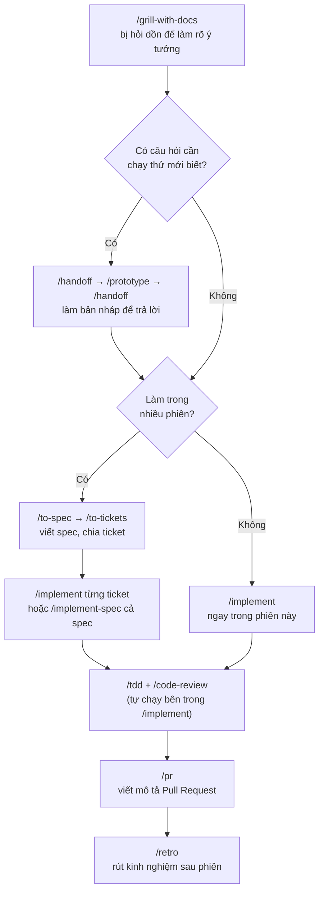

# Bảng tra cứu skill của Matt Pocock

Plugin `mattpocock-skills` bản 1.3.1, gồm 27 skill. Tài liệu này để tra nhanh skill nào làm gì và khi nào dùng.

## Cài đặt (mỗi thành viên làm một lần)

### 1. Cài Claude Code

Chọn một trong hai cách:

- **VS Code:** mở Extensions (`Ctrl+Shift+X`), tìm **Claude Code** (của Anthropic) rồi bấm Install.
- **Terminal:** mở PowerShell và chạy `irm https://claude.ai/install.ps1 | iex`, sau đó gõ `claude` trong thư mục dự án.

Lần đầu mở, Claude Code yêu cầu đăng nhập tài khoản Claude (gói Pro/Max) hoặc nhập API key.

### 2. Cài plugin

Repo đã khai báo sẵn plugin trong `.claude/settings.json`. Lần đầu mở Claude Code trong thư mục dự án, bạn chọn **tin tưởng thư mục** (trust), và Claude Code sẽ hỏi có cài `mattpocock-skills` không. Chọn đồng ý là xong; nếu vậy thì bỏ qua đến bước 3.

Nếu Claude Code không hỏi, gõ vào khung chat:

```
/plugin install mattpocock-skills@claude-plugins-official
```

Khi được hỏi phạm vi cài, chọn **User**: plugin dùng được ở mọi project trên máy bạn.

Nếu bị báo không tìm thấy marketplace, thêm marketplace chính thức của Anthropic trước rồi cài lại:

```
/plugin marketplace add anthropics/claude-plugins-official
/plugin install mattpocock-skills@claude-plugins-official
```

Cài xong thì khởi động lại Claude Code (hoặc mở một cửa sổ chat mới).

### 3. Kiểm tra

- Gõ `/` trong khung chat. Trong danh sách gợi ý phải có các skill bắt đầu bằng `mattpocock-skills:`, ví dụ `mattpocock-skills:tdd`.
- Hoặc gõ `/plugin`, mở tab **Installed**. Phải thấy `mattpocock-skills`, và phiên bản nên là 1.3.1. Nếu là bản khác thì danh sách skill có thể không khớp với tài liệu này.

### 4. Cập nhật, gỡ cài đặt

| Việc | Lệnh |
| --- | --- |
| Cập nhật danh sách plugin của marketplace | `/plugin marketplace update claude-plugins-official` |
| Cập nhật hoặc tắt plugin | Gõ `/plugin`, chọn `mattpocock-skills` ở tab Installed |
| Gỡ cài đặt | `/plugin uninstall mattpocock-skills@claude-plugins-official` |

Cả nhóm nên dùng cùng một phiên bản. Ai muốn cập nhật thì báo nhóm trước.

### 5. Thiết lập cho repo: chỉ một người làm

`/setup-matt-pocock-skills` ghi cấu hình vào repo: nơi quản lý ticket, bộ label, nơi lưu tài liệu. Chỉ **một người** chạy lệnh này, rồi đưa kết quả vào repo qua PR như mọi thay đổi khác. Hai người còn lại kéo `main` về là dùng được, không chạy lại. Repo đã có `CLAUDE.md`, nên người review cần xem kỹ lệnh này sửa gì trong file đó.

### Lưu ý với quy tắc làm việc của nhóm

Theo `CLAUDE.md`, con người quyết định còn AI đề xuất, và logic khó phải có mô tả luồng được duyệt trước khi viết code. Vì vậy:

- Hạn chế dùng `/implement-spec`. Skill này chạy nhiều subagent song song đến khi xong cả spec, nên khó giám sát từng bước.
- Ưu tiên dùng `/implement` theo từng ticket, và review diff sau mỗi ticket.

## Cách gọi

- Gõ `/` trong khung chat của Claude Code rồi gõ tên skill, ví dụ `/tdd`. Nếu trùng tên với skill khác, gõ đầy đủ `/mattpocock-skills:tdd`.
- **Claude tự gọi**: Claude tự dùng skill khi thấy yêu cầu phù hợp, bạn không cần gõ.
- **Bạn gọi**: skill chỉ chạy khi bạn gõ lệnh.
- **Lưu ý trùng tên:** Claude Code có sẵn một lệnh `/code-review` riêng. Muốn dùng bản của Matt, gõ `/mattpocock-skills:code-review`.
- Không nhớ dùng skill nào thì gõ `/ask-matt` và mô tả tình huống; skill này sẽ chỉ đường.
- Lần đầu dùng trong một repo, chạy `/setup-matt-pocock-skills` một lần (xem mục 5 ở trên). Nó hỏi bạn quản lý ticket ở đâu (GitHub Issues hay file local), dùng label gì, và lưu tài liệu ở đâu.

## Luồng chính: từ ý tưởng đến lúc ship

Phần lớn công việc đi theo luồng này. Các skill còn lại dùng độc lập hoặc nhập vào luồng ở giữa.



Từ bước grilling đến `/to-tickets` nên giữ trong **cùng một phiên chat**, không `/clear`, để spec và ticket dựa trên đúng những gì đã trao đổi. Sau đó mỗi `/implement` có thể bắt đầu ở phiên mới, chỉ cần đọc ticket.

## Tất cả skill

### Làm rõ yêu cầu và lên kế hoạch

| Skill | Làm gì | Ai gọi | Dùng cho StudyMate khi |
| --- | --- | --- | --- |
| `/grill-with-docs` | Hỏi dồn bạn về một kế hoạch hay thiết kế cho đến khi rõ; đồng thời ghi thuật ngữ vào `GLOSSARY.md` và ghi quyết định khó đảo ngược thành ADR | Bạn gọi | Trước mỗi tính năng lớn: chatbot RAG, sinh quiz, phân quyền |
| `/grill-me` | Giống trên nhưng không ghi tài liệu. Dùng khi không làm trong repo | Bạn gọi | Bàn ý tưởng ngoài code, ví dụ cách chia việc trong nhóm |
| `/grilling` | Phần lõi "hỏi dồn" mà hai skill trên dùng chung. Tự kích hoạt khi bạn nói "grill" | Claude tự gọi | Ít khi cần gọi trực tiếp |
| `/to-spec` | Tổng hợp cuộc trò chuyện hiện tại thành spec và đưa lên nơi quản lý ticket. Không hỏi thêm | Bạn gọi | Sau khi grilling xong một tính năng |
| `/to-tickets` | Chia spec hoặc kế hoạch thành các ticket nhỏ (mỗi ticket là một lát cắt chạy được từ đầu đến cuối), ghi rõ ticket nào phải chờ ticket nào | Bạn gọi | Chia việc cho TV1/TV2/TV3 mỗi tuần |
| `/wayfinder` | Với việc quá lớn và còn mơ hồ (không gói gọn trong một phiên): vẽ bản đồ các quyết định cần đưa ra, giải quyết từng quyết định một. Kết quả là các quyết định, không phải code | Bạn gọi | Chỉ khi cả nhóm còn mù mờ về một mảng lớn. Tính năng đã rõ thì không dùng |
| `/to-questionnaire` | Biến một quyết định bạn chưa tự trả lời được thành bảng câu hỏi để người khác điền | Bạn gọi | Cần hỏi ý giảng viên hoặc thành viên khác |
| `/triage` | Phân loại issue và PR từ bên ngoài (bug report, yêu cầu tính năng), kiểm tra, rồi viết lại thành ticket mà agent làm được | Bạn gọi | Khi có bug report từ người dùng thử. Ticket do `/to-tickets` tạo thì không cần triage |

### Viết code

| Skill | Làm gì | Ai gọi | Dùng cho StudyMate khi |
| --- | --- | --- | --- |
| `/implement` | Làm một phần việc dựa trên spec hoặc ticket; bên trong tự chạy `/tdd` và kết thúc bằng `/code-review` | Bạn gọi | Làm từng ticket. Nên `/clear` giữa các ticket |
| `/implement-spec` | Làm cả spec trong một lần: đọc các ticket thành đồ thị phụ thuộc, chạy nhiều subagent song song, gom kết quả về một nhánh tích hợp | Bạn gọi | Khi muốn giao cả tính năng một lần. Tốn token hơn |
| `/tdd` | Phát triển theo kiểu test trước: viết test fail (red), sửa code cho test qua (green), rồi dọn code (refactor). Có hướng dẫn thế nào là test tốt, test tồi | Claude tự gọi | Logic dễ sai: chấm điểm quiz, kiểm tra quyền vào lớp, gộp kết quả RRF |
| `/prototype` | Làm bản nháp dùng xong bỏ, để trả lời một câu hỏi thiết kế (luồng trạng thái có hợp lý không, giao diện trông ra sao) | Claude tự gọi | Thử giao diện chat, thử chia chunk trước khi làm thật |
| `/diagnosing-bugs` | Quy trình gỡ bug khó: chưa đoán nguyên nhân cho đến khi có một lệnh tái hiện được lỗi; sửa xong thì để lại test chống tái phát | Claude tự gọi | Bug khó: lỗi lúc có lúc không, SSE chạy ở local nhưng hỏng trên server |
| `/wizard` | Tạo một script bash hỏi-đáp để dẫn bạn qua những bước chỉ con người làm được (tạo tài khoản, điền secret, bấm trên dashboard) | Claude tự gọi | Deploy lên Vercel/Render/Supabase, cài secret cho GitHub Actions |

### Review và giao code

| Skill | Làm gì | Ai gọi | Dùng cho StudyMate khi |
| --- | --- | --- | --- |
| `/code-review` | Review thay đổi kể từ một mốc (commit, nhánh, tag) theo 2 trục chạy song song: **Standards** (đúng quy chuẩn code của repo chưa) và **Spec** (đúng yêu cầu của issue/spec chưa) | Claude tự gọi | Trước khi merge PR của thành viên khác. Gõ `/mattpocock-skills:code-review` |
| `/pr` | Viết mô tả Pull Request: hình minh họa nhỏ nhất cho thấy thay đổi, bằng chứng trước/sau là nó chạy, và đánh giá thay đổi có dễ hoàn tác không | Claude tự gọi | Mỗi lần mở PR |
| `/retro` | Nhìn lại phiên làm việc và đề xuất cải thiện môi trường (thêm check tự động, quy chuẩn code, chỉ dẫn cho agent), không sửa code | Bạn gọi | Cuối tuần, hoặc sau một phiên đi sai hướng |

### Thiết kế và chất lượng codebase

| Skill | Làm gì | Ai gọi | Dùng cho StudyMate khi |
| --- | --- | --- | --- |
| `/domain-modeling` | Làm rõ ngôn ngữ chung của dự án: chỉnh thuật ngữ mơ hồ, tách từ bị dùng cho nhiều nghĩa, ghi quyết định khó đảo ngược thành ADR | Claude tự gọi | Thống nhất cách gọi: "tài liệu" hay "document", "chunk", "lượt làm bài" |
| `/codebase-design` | Bộ từ vựng thiết kế "deep module": nhiều chức năng sau một interface nhỏ, đặt ranh giới (seam) ở chỗ hợp lý, để code dễ test và dễ cho AI đọc | Claude tự gọi | Thiết kế module RAG, module quiz |
| `/improve-codebase-architecture` | Quét codebase tìm chỗ nên gộp/làm sâu module, xuất báo cáo HTML, rồi hỏi dồn bạn về phương án bạn chọn | Bạn gọi | Khi rảnh, khoảng tuần 6–7, lúc code bắt đầu rối |

### Quản lý phiên làm việc

| Skill | Làm gì | Ai gọi | Dùng cho StudyMate khi |
| --- | --- | --- | --- |
| `/handoff` | Nén cuộc trò chuyện thành một file markdown để agent khác (hoặc đồng đội) làm tiếp | Bạn gọi | Chuyển việc cho thành viên khác, hoặc tách việc sang thư mục khác |
| `/wait-what` | "Khoan, câu vừa rồi khó hiểu quá": bắt Claude giải thích lại | Bạn gọi | Khi đọc câu trả lời mà không hiểu |
| `/teach` | Dạy bạn một kỹ năng hoặc khái niệm mới, dùng chính code trong repo làm ví dụ | Bạn gọi | Học pgvector, SSE, Prisma ngay trên dự án |

### Thiết lập và tiện ích

| Skill | Làm gì | Ai gọi | Dùng cho StudyMate khi |
| --- | --- | --- | --- |
| `/setup-matt-pocock-skills` | Cấu hình repo cho các skill: nơi quản lý ticket, bộ label, nơi lưu tài liệu | Bạn gọi | Chạy một lần trước khi dùng các skill khác |
| `/ask-matt` | Bộ chỉ đường: mô tả tình huống, nó gợi ý skill hoặc luồng phù hợp | Bạn gọi | Khi không nhớ dùng skill nào |
| `/writing-for-agents` | Hướng dẫn viết tài liệu cho agent đọc (skill, `CLAUDE.md`, `AGENTS.md`) | Claude tự gọi | Khi viết `CLAUDE.md` cho dự án |

## Gợi ý dùng theo tình huống

| Tình huống | Skill |
| --- | --- |
| Sắp làm tính năng mới | `/grill-with-docs` → `/to-spec` → `/to-tickets` → `/implement` |
| Sửa nhanh một việc nhỏ đã rõ | `/implement` (hoặc chỉ cần `/tdd`) |
| Có bug khó | `/diagnosing-bugs`, sửa xong chạy `/retro` |
| Chưa chắc thiết kế có ổn không | `/prototype` |
| Trước khi merge PR | `/mattpocock-skills:code-review` |
| Chuyển việc cho đồng đội | `/handoff` |
| Đọc câu trả lời mà không hiểu | `/wait-what` |
| Không nhớ dùng skill nào | `/ask-matt` |

Thư mục plugin còn một số skill trong nhóm `in-progress` và `misc` (ví dụ `setup-pre-commit`, `git-guardrails-claude-code`), nhưng chưa được đăng ký trong plugin nên không gọi được.
